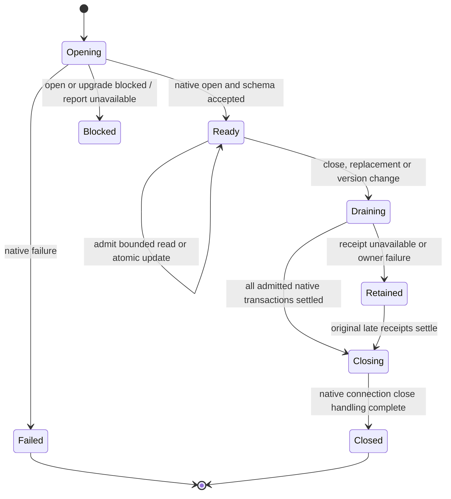
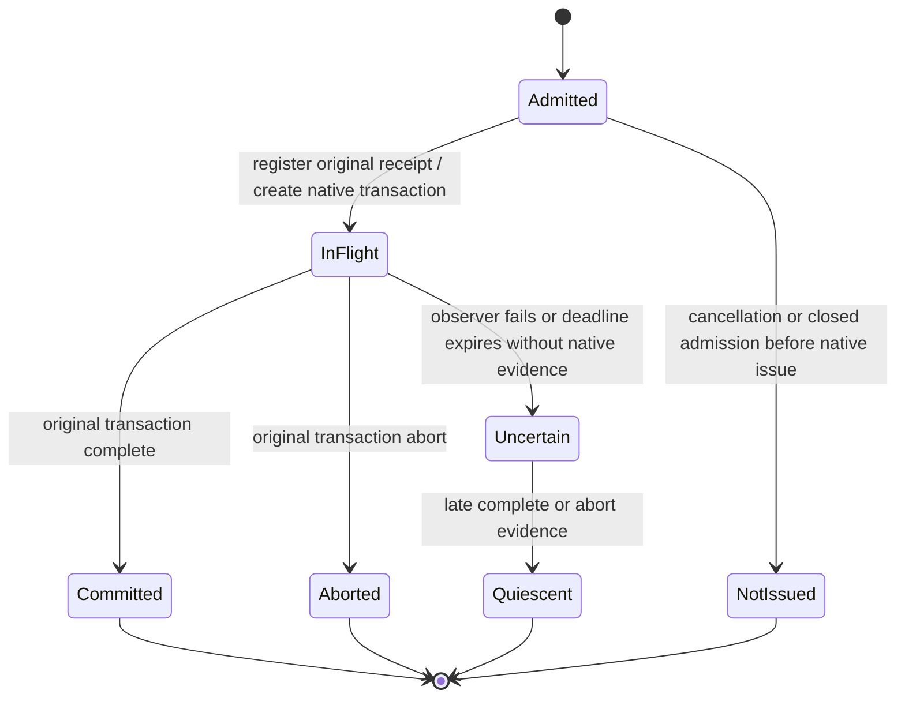

# W03: worker-owned IndexedDB AccountStore

Status: **IndexedDB selected by the user on 2026-11-13.** The reusable adapter
belongs in Local First; application workers access it directly. The previously
proposed permanent localStorage/Window lease architecture is superseded. Do not
implement or extract that architecture as W04's prerequisite.

The user explicitly removed migration and old-version compatibility from scope:
“we don't need to worry about migration. Whatever happens, happens. We're not
building extra code for it.” This resolves the outstanding W03 decision. Build
no legacy import, source cleanup, dual writes, fallback, forced reload or special
rollback/version-coordination mechanism. Existing localStorage values are ignored,
not deleted by this work. An absent IDB record is an ordinary empty store.

W03's design is complete under that instruction. W04 starts with the shared
inactive adapter/resource owner; its native/packed-consumer qualification is now
complete in the [W04 evidence](worker-account-store-verification.md). App adoption
remains W05. No existing browser data has been changed.

## Baseline and source findings

Research checkout: `feat/finance-worker-inventory`, based on monorepo `main`
`670fb720e15b15a4b308408c92301bd29a943561`. A fetch on 2026-11-13 confirmed
`origin/main` was at that revision during qualification. Before PR publication,
`main` was refreshed to `02f886be` (Clipper UI-only changes) and the foundation
branch was rebased onto it; the recorded test baselines remain unchanged.
No SDK version, live storage, user identity, server or deployment changed in W03.

Read the [inventory](worker-ownership-inventory.md),
[reuse specification](worker-foundation-reuse.md),
[backlog](worker-migration-tasks.md) and
[PR #67 dispositions](../../../../specs/002-monorepo-agent-guidance/finance-worker-pr67-review.md).
The latter source was inspected at `8ac042576360d82a21c64a643eab97f09e4bdf7c`,
including custody commit `f9b2fc94accdf6a9065ebe278daea48d3003e8bf`.

- Installed `jazz-tools@2.0.0-alpha.60` exposes a public `AccountStore` in
  `dist/accounts/persistence.d.ts`: asynchronous `read()` and atomic
  `update(transform)`. The synchronous transform may be retried by a transactional
  host; completion must follow durable replacement and failure must preserve the
  old value. This adapter will not automatically retry an unknown update.
- `dist/accounts/account-manager-core.js` uses `config.store` when supplied;
  localStorage is only its browser default. `JazzClientConfig` includes that
  option. Local First's [session adapter](../../../../packages/local-first/src/lib/backend/jazz/session.ts)
  already forwards it. No SDK patch or alternate session owner is required to
  supply an IndexedDB store.
- Finance's inactive [account owner](../../src/lib/machines/runtime/account-store-owner.ts),
  [operation](../../src/lib/machines/runtime/account-store-operation.ts) and
  [legacy cleanup](../../src/lib/machines/runtime/account-store-legacy.ts) currently
  orchestrate worker locks plus Window storage writes. Preserve their observable
  SDK transform and cancellation behavior, not that physical implementation.
  Legacy selection/import/cleanup is excluded by the new user instruction. Their
  split native lifetime is not needed for direct IndexedDB.
- Clipper's [scoped AccountStore](../../../clipper/apps/web/src/lib/runtime/worker/scoped-account-store.ts)
  and [receipt custody](../../../clipper/apps/web/src/lib/runtime/worker/account-write-custody.ts)
  have useful stop/error/reentrancy scenarios. Their worker-held Web Locks and
  Window data channels are not the target architecture either.
- Local First's [journal native adapter](../../../../packages/local-first/src/lib/machines/workspaces/journal-native.ts)
  and [journal transaction owner](../../../../packages/local-first/src/lib/machines/workspaces/journal.ts)
  provide native IDB acquisition/settlement patterns. Its
  [transaction custody](../../../../packages/local-first/src/lib/machines/workspaces/transaction-custody.ts)
  already owns private receipt bookkeeping and total handoff. Reuse compatible
  contracts; do not copy an entire workspace/restore journal to store one record.
- The [test app](../../../../packages/local-first/fixtures/test-app) and
  [packed consumers](../../../../packages/local-first/fixtures/package-consumer)
  offer native/consumer qualification patterns, not an existing IndexedDB
  AccountStore to import unchanged. No complete public adapter was found.

## Selected design and alternatives

A small IndexedDB bootstrap database stores the account-selection string before
opening the selected Jazz account. The worker performs one native read/write
transaction per SDK update. Every participating tab/worker uses the same logical
binding and database/object store, so IDB schedules conflicting updates.

| Alternative                                           | Decision                                                                                                                                      |
| ----------------------------------------------------- | --------------------------------------------------------------------------------------------------------------------------------------------- |
| IndexedDB accessed directly by the application worker | **Selected.** Transactional bootstrap storage without a steady-state Window write bridge or separate account Web Lock.                        |
| localStorage plus Window-held leases                  | **Superseded as the permanent design.** No compatibility writer or remote-lock service is needed under the latest user instruction.           |
| OPFS                                                  | Not selected. File-oriented atomic replacement/recovery adds work without an identified need for this small record.                           |
| Store only inside the selected account's Jazz data    | Not selected. Opening that account already requires the retained bootstrap identity/root information. Do not edit SDK-private database files. |

The [IndexedDB API](https://www.w3.org/TR/IndexedDB-3/#idl-index) is exposed to
Window and Worker. Its [transaction scheduling](https://www.w3.org/TR/IndexedDB-3/#transaction-scheduling)
serializes overlapping write transactions. Successful request completion is
separate from transaction completion. The
[durability hint](https://www.w3.org/TR/IndexedDB-3/#transaction-durability-hint)
permits requesting `strict` durability; select that for identity updates and
qualify actual supported browser behavior. These platform contracts support the
design; they are not new browser qualification evidence.

Direct IDB removes the old lock-versus-queued-Window-write race. It does not
remove unknown outcomes when the worker disappears after commit but before its
caller observes completion. It does not establish Jazz replica durability,
remote acceptance, financial transaction settlement or immunity from same-origin
malicious code. Account selection still contains sensitive identity material.

## Ownership and public boundary

| Owner                            | Responsibility and lifetime                                                                                                                                                 |
| -------------------------------- | --------------------------------------------------------------------------------------------------------------------------------------------------------------------------- |
| Local First IndexedDB adapter    | Own database open, bounded call admission, atomic native updates, original completion/abort receipts and close. No account/legacy selection or domain policy.               |
| Local First SDK integration      | Present the supported `AccountStore` interface and thread one stable store capability through the existing startup/session configuration. No new session registry.          |
| Worker application/session owner | Retain the store through SDK startup, shutdown and any issued calls. Drain SDK work before closing the store. Coordinate replacement using the existing lifetime hierarchy. |
| Finance configuration            | Supply stable app/profile bindings. Keep SDK account-selection semantics; add no legacy import or cleanup owner.                                                            |
| Clipper adoption owner           | Preserve web and extension/offscreen logical identities and adapt each consumer to the same shared storage implementation. No library default `:clipper` key.               |

The shared API accepts an explicit stable database namespace and logical record
binding. Preserve the existing app's registry/environment identity mapping;
changing storage medium must not silently change which account the app opens.
A fresh operation/generation identifies each attachment and receipt. No arbitrary
UI-provided database/key, SDK handle, function or actor snapshot crosses a port.
Subpath names and concrete files are finalized in W04's implementation review.
No additional dependency is proposed; use existing native IDB patterns.

Store the SDK's account-selection string without replacing its representation or
interpreting its roots in the generic adapter. Only an absent record returns `null`. Blocked open, read failure, unexpected
record type and corrupt/oversized data are failures, not empty stores. Do not
add migration metadata or an initialized-target marker when there is no import
or fallback path to coordinate.

## Atomic update and lifecycle

The transaction performs one selected native operation: get the current string,
call the synchronous SDK transform, validate the returned representation bounds,
and put the replacement before the active IDB callback returns. No network,
arbitrary await or inter-actor round trip may split those commands. The app/SDK
owns account policy; the native adapter does not select an alternative workflow
inside the callback. A thrown transform or failed native command aborts the
transaction. Never resolve update on `put.onsuccess`.

The statechart owns admission and transaction/receipt lifetime around that
bounded atomic primitive. Model the actual native timing rather than creating
an asynchronous state boundary between every IDB request and its dependent put.

- Register receipt ownership before issue, including synchronous reentrant
  disposal. SDK caller settlement happens once. A late receipt can permit cleanup
  without rewriting an already delivered unknown result as success.
- Retain bounded active/queued calls: preserve Finance's eight-call bound and
  Clipper's eight admitted updates. Native IDB transactions serialize conflicting
  updates; do not transplant the old two-remote-lease capacity rule.
- Closing refuses new calls. Drain admitted native transactions and handle
  `versionchange` without leaving a connection blocking future upgrades. A
  blocked open is not an empty account selection or permission to delete a DB.
  Retain the original pending open request on cancellation/failure and close any
  late successful connection; do not orphan it or start unbounded replacement opens.
- Cancellation before native issue prevents effects. Once issued, retain native
  receipts; do not report rollback merely because the caller/actor stopped or a
  deadline expired. An explicit abort succeeds only when the native transaction
  reports its outcome. `db.close()` returning is not a transaction receipt.
- A stopped/erroring workflow must hand the existing original receipts to its
  longer-lived resource owner. Use Local First's compatible custody contract;
  any new native receipt observer must have an explicit owner and error path.
- Whole-worker/browser loss has no surviving application Promise recipient.
  Qualify that IDB exposes an atomic committed-or-aborted record to the next
  worker, then reopen and reconcile the actual selection. Do not replay the old
  transform from a vanished or rejected Promise. Never claim a commit receipt
  that the dead caller did not observe.
- Reads use IDB only. No missing/empty/failed IDB result causes localStorage
  fallback. Ordinary SDK first-use behavior handles a genuinely absent record.

## Explicitly excluded compatibility work

The user's latest instruction supersedes earlier identity-import, old/new-tab
coexistence and rollback requirements for this storage replacement. Do not add
migration markers, legacy snapshot ports, earlier-key discovery/scrubbing,
dual-store transactions, source deletion, compatibility releases, old-tab
retirement checks or forced reload coordination. Neither the library nor the
apps need to inspect old localStorage account records for the new store.

The generic library still preserves atomic SDK updates, native errors, actual
settlement and bounded close. Those are steady-state correctness requirements,
not compatibility work. Existing backup/restore and financial-data features are
outside this account-store slice; the instruction does not request actively
clearing their data or resetting a user server.

## Revised reuse decisions

| Material                                                                          | Decision under IndexedDB                                                                                                                                                                                                                                            |
| --------------------------------------------------------------------------------- | ------------------------------------------------------------------------------------------------------------------------------------------------------------------------------------------------------------------------------------------------------------------- |
| Existing Local First session/startup, transaction custody and native IDB patterns | Reuse compatible public contracts and native patterns; add the missing shared AccountStore. No duplicate session owner or general journal framework.                                                                                                                |
| Clipper R1 independent close control                                              | Still extract for the browser broker and other required Window capabilities. It is not an IDB commit or connection-close receipt.                                                                                                                                   |
| Clipper R2 account-storage data channel                                           | Retire after IDB adoption. No temporary import or compatibility extraction is required.                                                                                                                                                                             |
| Clipper R2 Jazz broker/generation adapter                                         | Still extract. The SDK's broker host/generation storage is separate from account selection; IndexedDB AccountStore does not silently migrate those keys or remove SharedWorker construction needs. Preserve exact capability admission and no unknown-write replay. |
| Clipper R3 ledger/keeper                                                          | Reuse receipt-before-issue, reentrancy and stop/error scenarios. Adapt a narrow missing mechanism only where existing Local First custody is insufficient. Do not port remote-lock ownership or same-realm keepers as the IDB crash guarantee.                      |
| Finance account/legacy charts                                                     | Replace the inactive lock/read/transform/Window-write pipeline with the shared atomic store. Do not port legacy import, earlier-key discovery or cleanup.                                                                                                           |
| PR #67 native Window-lock implementation                                          | Leave out of the selected permanent architecture. Retain relevant failure/unknown-outcome requirements; its remote-lock tests do not establish native IDB correctness.                                                                                              |
| PR #67 shell/routes and Clipper article/reader/domain host                        | Leave in their source applications; no wholesale runtime import.                                                                                                                                                                                                    |
| R4 disposable worker jobs                                                         | Unchanged, still a later independent extraction before finite image/provider job adoption.                                                                                                                                                                          |

## Revised delivery and required qualification

W04 first implements the small public IndexedDB store and its resource/receipt
owner in Local First. Show the concrete implementation before its tests under
the current review gate. Qualify its public packed consumer and real workers,
then adopt it in Clipper/Finance through separate bounded review cycles. W04
qualification must not wait for production UI cutover.

W05 implements app bindings, extracts the still-required broker/close
mechanisms, and removes superseded account storage/lock transports after both
consumers qualify. It contains no migration work. W06 then qualifies the
single persistent worker SDK owner. W08 still owns full financial-runtime
shutdown joins. No production activation is implied by these foundations.

| Future test boundary                                               | Independent observable acceptance                                                                                                                        |
| ------------------------------------------------------------------ | -------------------------------------------------------------------------------------------------------------------------------------------------------- |
| Concurrent tabs/workers on one binding                             | Both transforms read serialized current data and preserve each other's changes; no lost update. Distinct app/profile bindings remain isolated.           |
| Transaction put succeeds, later transaction aborts                 | Old value remains; SDK update did not resolve as successful.                                                                                             |
| Native completion/abort, quota/open/upgrade/version-change errors  | Correct completion and sanitized failure; no false empty selection, database reset, fallback store or request-success acknowledgement.                   |
| Stop/error, cancellation and reentrant cleanup around issue/commit | Original receipt already owned; caller settles once, close waits for native settlement, unknown writes are not replayed.                                 |
| Real worker termination before/around/after commit                 | Reopened record is atomic and valid; no queued Window account write can overwrite it; unknown caller result is not fabricated.                           |
| Finance and Clipper web/extension consumers                        | Same identities and logical namespaces; real production worker/Wasm builds, close and cold offline reopen pass with removed storage bridges unavailable. |

Retain bounded generated scenarios with the pinned `@xstate/test`, independent
oracles, recorded seeds/bounds/coverage and shrunk replay artifacts. Native
Chromium/Firefox/WebKit tests, library packaging/public consumer imports and both
app integrations are required after implementation review. W01/W02 test counts
are not IDB verification. No new implementation/native tests ran for this design.

## W04 implementation and qualification

Public export: `backend/jazz/account-store/indexeddb`. The constructor captures
an explicit database name/key and optional injected IDB factory, creates one
store owner at the SDK/native boundary, and returns `read`, `update` and graceful
`close`. No app startup caller is added in this slice.

The owner holds at most eight calls including its current call, executes them in
FIFO order, and owns opening, running/idle/busy, draining, closing and closed
states. Native callbacks perform the bounded atomic get/transform/put, retain
original transaction completion/abort handlers after actor disposal, and close
late-opened connections. The native close receipt survives a failed actor and
waits for pending native open/transaction settlement. It is not SDK or financial
runtime closure evidence. No native timeout is invented.

Use strict `readwrite` transactions for updates; reject oversized/non-string
values and errors without exposing their payloads. The constructor starts no
SDK and reads no localStorage. Packaging/types/format/lint may check the concrete
change. The user subsequently reviewed this concrete code and approved its
implementation tests. No test approval from W02 was reused for W04.

## W04 evidence

The first slice contains four TypeScript files, one public package export and
[Local First usage/lifetime documentation](../../../../packages/local-first/docs/indexeddb-account-store.md):

- `contracts/indexeddb-account-store.ts`: bounded worker-local calls/results and
  native receipt capability.
- `storage/indexeddb-account-store-native.ts`: IDB open, atomic read/update and
  original transaction/open settlement retained through native close.
- `machines/identity/indexeddb-account-store.ts`: FIFO admission, running/draining/
  closing ownership and unexpected-failure handling.
- `backend/jazz/indexeddb-account-store.ts`: SDK AccountStore facade and one root
  resource owner; no application startup integration.

Static validation: Local First library types report zero errors/warnings;
changed-source Oxfmt/Oxlint pass; `pnpm build:libraries` packages both libraries
and passes strict publint for the new public export. Initial type checking caught
`Promise.withResolvers` outside Local First's ES2022 declarations; the native
receipt now uses an ordinary Promise without changing the package target.
No catalog/dependency/SDK patch or live data change is included. Raw checks are
retained locally under `/private/tmp/finance-worker-w04-670fb720/`.

Static checks alone did not establish native correctness. After the user's
implementation/test approval, all 1,111 unit tests and 60 native browser cases
passed; see the [complete verification record](worker-account-store-verification.md).
It records the real stored-undefined bug and cursor fix, exact native scenarios,
packed export checks, failed setup/oracle attempts and limits. W04 is complete
as the shared foundation; actual Finance/Clipper adoption remains W05. The current
Window-owned application is still active.
