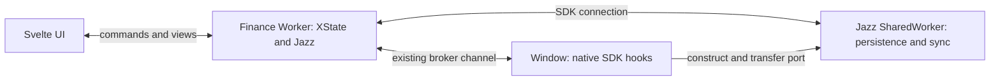

# Simpler Finance worker design

Status: the user approved starting this design on 2026-11-16, including the
session-level bridge proposed for review. The initial real-SDK fixture is now
implemented; the WebKit worker-entry duplication is corrected through the shared
Local First worker build settings used by Finance and Clipper. After C1 removes
the abandoned grant/call prototype, all 12 retained SDK/IndexedDB native cases
pass, including WebKit and full browser restarts. See the
[startup research](worker-webkit-startup-research.md). Stop extending
the grant/call-owner architecture. No production runtime cutover is implemented.

Subsequent [alpha.61–65 source research](worker-jazz-release-research.md) identifies
native immediate local-first startup and a session-owned account API that can
simplify this integration. A coordinated upgrade is proposed for review;
workspace versions remain alpha.60. The unpatched alpha.65 probe loses worker
rows across a full restart, so the persistent worker bridge is still required.

The complete [seven-item simplification checklist](worker-migration-tasks.md#seven-item-simplification-checklist)
records the proposed cleanup, ownership, read-view, financial-workflow and test/
spec tasks. Its execution notes distinguish deletion of confirmed-unused
prototypes from replacement of live behavior and place the coordinated SDK
upgrade before new worker integration glue. C1/C2 remove the unused grant/call
prototype and Window account-storage bridge, including their bespoke tooling.
The checklist records both audits and the remaining C3–C7 scope.

## Start with the actual application

One dedicated application Worker per tab runs the existing Finance domain
machines and Jazz client. Svelte renders bounded view data and sends user
commands through native `postMessage`. Jazz keeps owning its persistent replica,
authorization, synchronization, generation selection and internal connections.

The Window hooks exist because this SDK path needs Window's SharedWorker
constructor and generation storage. Once a port is transferred, Jazz speaks to
its worker directly. Financial queries, validation and domain decisions stay in
the application Worker. DOM, focus, navigation and Window-only interactions stay
with Svelte/native browser APIs.

## Reuse rather than add another coordination layer

| Responsibility                                                       | Starting point                                                                                                                                        |
| -------------------------------------------------------------------- | ----------------------------------------------------------------------------------------------------------------------------------------------------- |
| Persistent SDK and identity                                          | Existing Jazz client configuration and Local First session acquisition/startup APIs.                                                                  |
| Account selection                                                    | The qualified Local First IndexedDB AccountStore; preserve the user's no-migration decision.                                                          |
| Window SDK hooks                                                     | One shared `brokerHostClient`/`serveBrowserWorkerHost` connection for the application-worker lifetime. Clipper re-exports the same Local First setup. |
| Request bounds, transport errors, transferred-port custody and close | The existing shared channel and native close protocol behind that broker.                                                                             |
| Application workflow                                                 | Normal XState actors and existing invoked domain children in the Worker.                                                                              |
| Rendering and observation                                            | Svelte bindings and the existing synchronous store subscription contract, fed by selected worker views.                                               |
| Cross-thread communication                                           | Native Worker/MessagePort messages and transfer lists with typed, validated app command/view boundaries.                                              |

Do not mirror XState snapshots into another state machine on Window. Do not
create an actor for each SDK callback or a generic remote-actor/RPC framework.
Keep real financial operation identity, interruption and uncertain-write behavior
in the existing domain workflows. Moving code across a thread does not require
reimplementing those workflows or Jazz's internal request lifecycle.

The shared Window setup lives in Local First's existing public
`backend/jazz/worker-broker` module. Clipper retains same-origin admission;
Finance's real-SDK fixture additionally selects the configured broker asset
pathname. SDK version queries, names and generation keys pass through unchanged
after bounded wire validation. The root workspace Jazz patch already serves
both apps and stays there; this extraction adds no patch or lifecycle manager.
The former WebKit SDK-worker failure and its shared build correction are recorded
below and in the startup research.

The existing shared channel records a request fault and leaves accepting before
later requests can use that channel. It already handles callback delivery and
unclaimed native resources. With one channel, a fallback SDK request returns to
that same channel; it does not acquire a new grant. This removes the reason for
a second population-wide fault acknowledgement and separate call reservation.
SDK behavior and actual failure/close ordering still need integration tests.

## The design change that makes this smaller

Replace dynamically acquired exact-key/exact-name grants with one private
connection scoped to the trusted Finance Worker/session. At the Window boundary,
validate message shape, scope, bounded strings, the configured same-origin Jazz
broker asset and the SDK generation-key/name conventions. Let Jazz supply names
and keys; do not copy its namespace algorithm. Reuse the existing channel's
bounded requests and native host bounds instead of adding another aggregate
grant/callback budget and producer queue.

This changes the earlier exact-per-binding capability decision. The proposed
Window connection can serve multiple Jazz-selected names/keys within the session
instead of acquiring a separate capability for each. Database access remains
enforced by Jazz. The broader native-hook admission is nevertheless a real policy
change and must be agreed before replacing the exact-grant adapters. Clipper is
the concrete precedent, not proof of Finance's full identity/offline parity.

The installed SDK's `browserWorkerHost` hook is supplied by the repository's
**existing Jazz patch**, not upstream alpha.60. Keep that distinction explicit.
This proposal uses it unchanged and adds no patch. An entirely unpatched SDK
would require a separate supported-path investigation; do not promise that the
same dedicated-worker persistence path works unpatched.

## Keep shutdown at the session boundary

The application/session lifecycle stops new domain work, drains issued financial
operations and any pending acquisition, closes the actual Jazz session, then
closes the account store and broker connection through their existing APIs.
Only an observed clean result permits normal Worker termination. Svelte route
unsubscribe detaches UI observations; it must not terminate active financial work.
Window/worker crashes remain distinct from graceful shutdown, with no automatic
replay of unknown mutations. Reuse the corresponding Clipper/Local First behavior,
without copying Clipper's unrelated article/extension coordination.

## Prove one small vertical slice, then remove replaced machinery

1. Review the session-level native-hook boundary above. Keep native construction
   constrained to the configured Jazz asset and retain input/resource validation.
2. In the disposable worker fixture, open the **actual Jazz client** with the IDB
   AccountStore and one existing broker connection. Read a real scoped Finance
   query, save locally offline, close, reopen and verify the same identity/data.
   Cover multiple tabs, SDK failure/fallback and close during startup. The proof
   must exercise the SDK, not only a simulated promise recipient or factory list.
3. Connect one read-only Finance view using a small command/view union and Svelte
   subscription. Then move one existing financial form/workflow into the Worker.
   Preserve domain tests and add boundary/offline tests for the actual moved flow.
4. Remove confirmed-unused experimental grant/call machinery through C1–C3's
   import-audit gates; it need not be ported into the new implementation. Retain
   anything serving live behavior until its replacement is qualified. Drop
   PR #39's unneeded shared interruption-type extension only if no remaining
   consumer needs it. Keep the shared broker/channel/IDB foundations used by
   Clipper; do not rewrite or unpublish those APIs just to shrink Finance.

Defer broader abstractions until a second real consumer demonstrates a missing
shared capability. Preserve the product/parity requirements in W01–W21; replace
their overbuilt implementation sequence rather than adding another prerequisite
framework. The existing Window application remains active until qualified cutover.

## Inspected code

- [Clipper SDK bootstrap](../../../clipper/apps/web/src/lib/runtime/worker/serve-application.ts)
  constructs one broker and supplies it directly to the Jazz configuration.
- [Clipper broker policy](../../../clipper/apps/web/src/lib/runtime/worker/broker-channel.ts)
  re-exports the shared same-origin Window setup.
- [Shared broker](../../../../packages/local-first/src/lib/backend/jazz/worker-broker.ts)
  supplies the three SDK callbacks through the existing channel.
- [Channel lifecycle](../../../../packages/local-first/src/lib/machines/lifecycle/worker-channel.ts)
  owns request admission, faults, custody and native close.
- [Existing SDK patch](../../../../patches/jazz-tools@2.0.0-alpha.60.patch)
  supplies `browserWorkerHost` and dedicated-worker persistence support. Installed
  source was checked for SDK generation fallback and SharedWorker shutdown.

## First implementation checkpoint

The existing native-binding fixture now has a small SDK test Worker and Window
control. They use `createJazzClient`, one shared broker client/host and the
qualified IndexedDB AccountStore. No new production owner, grant, callback
machine, SDK patch or library API was added. The actual Finance schema is queried
and written in the Worker; test seeding is fixture setup, not app bootstrap code.

The worker test saves and edits an expense with browser networking disabled,
closes the actual SDK/store/broker, terminates the Worker, and restarts the entire
browser twice using its disposable persistent profile. Both reopens must retain
the original account and exact edited transaction. Native hook counters require
real SDK generation reads and SharedWorker construction. The fixture serves only
static assets: `/jazz` and auth services are unavailable throughout. Static assets
are loaded before browser-offline mode; this does not qualify PWA asset delivery,
server authorization, sync, multiple tabs or close during pending startup.

Results at this checkpoint:

- Chromium and Firefox pass all three cold browser cycles.
- A native Window SDK startup/upgrade control passes in Chromium, Firefox and
  WebKit. Final selected verification is five passes; the other 25 cases were
  not selected in that command. Browser-fixture TypeScript passes.
- WebKit's Worker fails on its first local-first upgrade with
  `invalid_account_handle`, after `createJazzClient` returned a ready session.
  Its stack reaches SDK `accountRegistry` through `accountContextScope`,
  `createAccountDbWithRuntimeSource`, `createRegisteredJazzClient` and the
  session upgrade. Removing automatic upgrading and testing explicit upgrading
  alone still fails. An unminified control also fails; normal minification was
  restored. At this checkpoint the cause was unresolved. Subsequent
  [research](worker-webkit-startup-research.md) establishes duplicate worker-entry
  evaluation and verifies two build-only corrections. The selected ES-module
  single-bundle correction is now shared by both apps through Local First;
  the case remains enabled and passes.

The first fixture build found both the SDK's emitted immutable broker asset and
its separately bundled constructor branch. Asset selection now requires the
single immutable SDK broker asset under the configured worker asset path. That
setup failure ran no SDK case. No runtime namespace algorithm was copied.

Preserved logs use `/private/tmp/finance-simple-sdk-*.log`; original WebKit build/
profile artifacts remain in `.svelte-kit/finance-binding-native-HwjwkG`,
`finance-binding-native-gni8pM`, `finance-binding-native-ZO4ABR` and
`finance-binding-native-ewC0eU`. Do not retry unchanged startup or remove the old
implementation as if full application replacement were qualified. The selected
build correction disables worker code splitting while preserving ES output;
no different initialization approach or dependency patch is needed for this
failure. The production application remains Window-owned.

## Shared Window setup checkpoint

The user requested sharing the remaining Window setup in Local First. Clipper
and Finance's real-SDK fixture now use `serveBrowserWorkerHost` from the existing
public Jazz broker module; the request and close lifecycles are unchanged.
Qualification passes: 47 shared broker cases, four Clipper broker/model cases,
two Clipper native broker cases, the five selected Finance SDK browser controls
above, the packed transport consumers, library types, Clipper web/extension types,
and Finance browser-fixture types. Clipper's first native attempt encountered an
old Vite prebundle missing the new export; refreshing only this isolated
checkout's cache resolved it. Logs use
`/private/tmp/finance-shared-browser-host-*.log`. This extraction did not resolve
or disable the WebKit worker failure. The subsequent build experiments are
recorded in the startup research; the separate offline-edit CI failure remains.
These are historical checkpoint results. The research's extension-origin
correction supersedes the earlier failure attribution and records current local
and hosted evidence.

## Shared build correction checkpoint

`jazzWorkerOptions` in Local First's public `backend/jazz/worker-build` module
supplies the same single-bundle ES-module policy to Finance, Clipper web and
Clipper's extension. Each app retains its SDK asset resolution and output paths.
The original runtime, account store and SDK patch are unchanged. Qualification
and the later extension-origin correction are recorded in the startup research.
