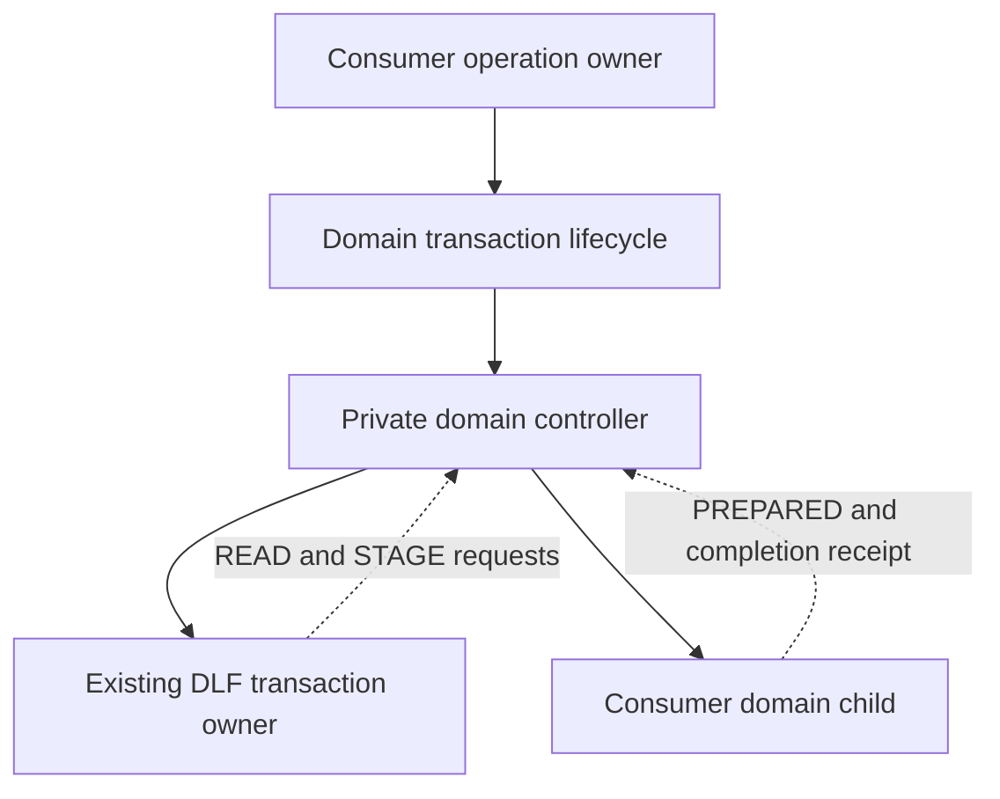

# Domain transaction composition

The `transactions/workflow` subpath exposes `createDomainTransaction` for a
consumer whose read/check/stage decisions belong to a domain chart. It composes
that chart with the existing DLF transaction owner. It opens one transaction;
it does not copy or replace acquisition, commit, local persistence, rollback or
detached custody.

## Public contracts

Import `createDomainTransaction` from `delightful-local-first/transactions/workflow`
and its types from `delightful-local-first/transactions/contracts`.

The factory has four type parameters: `Draft`, `Resource`, `Write`, `Receipt`.
Consumers supply:

- A typed domain spawn capability receiving the acquired resource, original
  attempt and preparation-report port, and returning the actual domain child.
- A lifecycle capability with `open`, `commit`, `persistLocal`, `rollback` and
  `retainDetached`. These remain native leaves of the existing transaction owner.

The operation input contains `attempt`. Its output preserves that original
attempt and the existing settlement union, with the consumer's receipt replacing
workspace-specific result data. `TransactionAttempt` is an alias of the existing
attempt contract, including its stable operation/workspace/membership identities;
this extraction does not migrate identities or change legacy workspace APIs.
A receipt must be an actual value, not `undefined`; it represents staged output,
not remote acceptance.

## Ownership and protocol

Only `CANCEL` and `SHUTDOWN` are public lifecycle commands. Native read/stage
request and reply messages are private to the controller. The domain receives a
`PREPARED` report capability and accepts `STAGE`; it must perform the selected
mutation before it completes with a receipt. Existing consumer charts may use
self-only `STAGED` acknowledgment to preserve queued-effect ordering.

The controller spawns the selected domain after native acquisition and read
admission. Its `reading` state waits for preparation assessment; `awaitingStage`
waits for DLF's stage permission; `staging` waits for the domain result. Domain
failure rejects the pending read or stage promise, allowing DLF to select
rollback/settlement. Exiting the controller's domain-processing state stops the
domain child and releases its reference; the native owner continues through
commit/settlement. No domain facts are attached to a native transaction handle.

Cancellation and shutdown go to the existing transaction owner and wait for its
actual result; they do not forcibly stop an issued write. Native detached custody
stays with DLF's existing owner. Domain eligibility, mutation choice, scope policy
and remote-receipt interpretation remain consumer-owned. The generic modules have
no Jazz, Clipper, schema, route or localization imports.

## Extraction review and qualification

This first implementation preserves Clipper's existing bridge statechart and
ordering, parameterizes its native resource and receipt, and exposes it through
DLF. Clipper's local resource defaults and native adapter remain in Clipper.
The existing workspace creation export is unchanged.

After implementation review and approval, the domain-free protocol tests cover
admitted/blocked reads, mutation-before-completion, read/stage failure,
cancellation during acquisition/read/stage/commit, rollback failure, unknown
commit/local-persistence outcomes, and forced-stop custody of an issued commit.
They preserve exact
original attempt and receipt identities. A generated interruption campaign uses
an independent behavioral model, seed `20261110`, and 150 runs.

The workspace transaction and scoped-form regression selection passes 247 tests
across ten files. Strict library checks, package generation with strict publint,
and the complete package-consumer command also pass. The new public consumer
fixture exercises the runtime export and checks that read/stage requests remain
outside the public actor protocol. Formatting, lint and whitespace checks pass.

The reviewed merged DLF uses Jazz alpha.59; Clipper pins an adapted alpha.60
artifact. This generic source extraction does not upgrade either backend adapter.
Clipper's initial compatible archive overlaid only the two new bridge modules and exports
onto its existing alpha.60 package, preserving all native adapter bytes. Its
existing recovery-view patch applies separately at installation. Clipper's full
663-test unit/native integration suite, web
and extension type checks, vendor verification and production build pass against
that archive. Clipper's pnpm commands use its managed Node `24.22.2`; DLF's local
checks use Node `25.2.1`, supported by DLF. Against the installed artifact,
Clipper's six worker browser tests, 12 packaged-extension tests and eight
production offline tests also pass. The offline suite includes linked, existing
and expired-credential accounts across complete browser restarts, persisted
offline edits and reconnection. This qualifies the extraction's current consumer
paths; it does not complete the broader workflow-hardening specification or
establish remote durability for arbitrary consumers. The subsequent compatible
artifact also includes the qualified owned-operation supervisor; see
[consumer adoption](owned-operation.md#consumer-adoption) for its source pin,
ten caller migrations and final 673-test consumer qualification.
