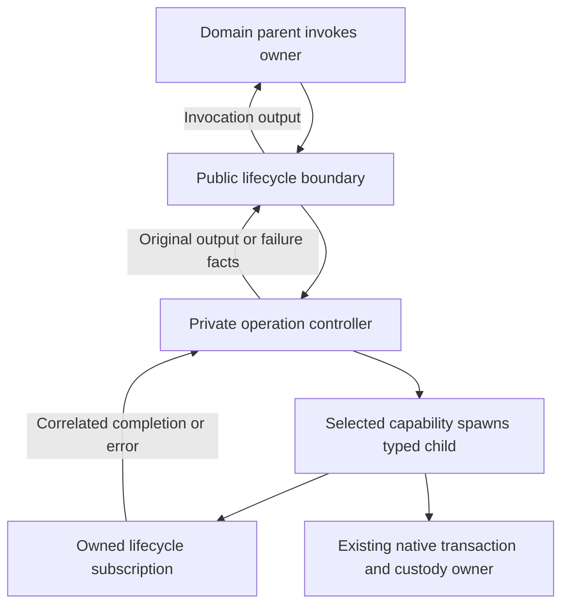

# Owned operation lifecycle

Import `createOwnedOperation<Input, Output, Command>()` from
`delightful-local-first/lifecycle/operation/workflow` and its types from
`delightful-local-first/lifecycle/operation/contracts`.

## Ownership and protocol

The parent selects a spawn capability, operation input and stable operation ID.
The supervisor calls that capability once and owns its returned child and
lifecycle subscription. The capability must spawn and return the selected child
under the supplied owner. It must be a pure synchronous adapter over the supplied
spawn capability; native work starts in the child, not in that adapter.
Domain branches, transaction acquisition/commit,
receipt interpretation, retries and native custody retain their existing owners.

The input is `{ operationId, input, spawn }`. The wrapper passes that operation
directly to its controller without relying on a same-state entry patch. The
public boundary accepts lifecycle commands only; child reports remain private.
Ownership references and result data have separate immutable context records so
cleanup cannot overwrite settlement patches. These capabilities are in memory,
not durable checkpoints.

```mermaid
stateDiagram-v2
    [*] --> active: Spawn selected child and subscribe
    active --> draining: DRAIN / no child command
    active --> draining: INTERRUPT / queue supported command
    active --> settled: Child completes or fails
    draining --> draining: Ignore further lifecycle requests
    draining --> settled: Child completes or fails
    settled --> [*]: Stop subscription and child; release references
```

`DRAIN` waits without commanding the child. `INTERRUPT` carries one concrete
sendable child command and then waits. The first request wins; repeated or
competing requests do not send another command. The default `Command = never`
permits drain-only use. A shutdown-only child cannot receive cancellation through
this contract. There is no timeout that invents the disposition of a native write.

`{ kind: 'completed', operationId, output }` preserves the child's exact output
and identity, including domain refusals and unresolved settlement. The parent
interprets those outcomes. `{ kind: 'failed', operationId, error }` reports a
spawn, child or controller failure; it does not establish that no effect occurred
or permit replay. Preserve the parent's existing unknown-outcome policy.

Completion/error reports match the one owned child's ID. Normal cleanup stops
both child and subscription and releases their references. Forced parent stop
cascades through these actors; the existing native owner must retain issued work
under its own custody protocol. The helper never reports a successful drain for
a forced stop. A pre-start queued request does not promise acquisition never
started: refusal before admission belongs in the parent.

## XState v6 composition

The current capabilities return actor refs, so an explicit spawn owner is needed.
Prefer ordinary typed invocation wherever a consumer can supply concrete logic.
The helper has no global registry, actor roots, Jazz imports or domain schema.
Its active/draining substates retain the same child without reentry.

The generic command is delivered by a named, queued action calling the child's
typed `send`. This beta's `enq.sendTo` uses a conditional event type that TypeScript
cannot resolve for an open command parameter. The queued action preserves the
concrete protocol without casts, widening or XState patches. Messages to the
fixed controller invocation use `enq.sendTo` normally.

The subscription has an error observer. The owning state's `onError` also handles
the native child-error event and errors during spawn/subscription setup. The
first settlement ends the controller; later reports cannot restart work.

## Clipper migration map

Rechecked against implementation branch baseline `168cd0b`. Keep each parent's
domain decisions, scope checks and result handling local.

| Parent state | Child output | Shutdown policy | Behavior retained in parent |
| --- | --- | --- | --- |
| Save record: intent | `StageResult` | Interrupt with `SHUTDOWN` | Publication admission, scope/refusal/uncertainty and receipts. |
| Save record: publication | `StageResult` | Interrupt with `SHUTDOWN` | Final save outcome and receipts. |
| Save article: ensure | `ArticleStageResult` | Interrupt with `SHUTDOWN` | URL/duplicate admission and subsequent content work. |
| Save article: attachment | `ArticleStageResult` | Interrupt with `SHUTDOWN` | Refusal-driven reread and attachment selection. |
| Save article: content | `SaveResult` | Interrupt with `SHUTDOWN` only | Content interpretation; child has no cancel command. |
| Organization: writing | `OrganizationStageResult` | Interrupt with `SHUTDOWN` | History, scope checks and local settlement. |
| Images: saving ready | `ImageStageResult` | Drain without interruption | Ready/uncertain bookkeeping and receipt watch. |
| Images: saving failure | `ImageStageResult` | Drain without interruption | Failure/uncertain bookkeeping and receipt watch. |
| Reader: writing | `ReaderStageResult` | Drain without interruption | Issued change, queue, drafts and receipt watch. |
| Samples: writing | `WorkspaceCreationResult<FakeDataPlan, number>` | Interrupt with `SHUTDOWN` | Sample gating and seeded/skipped/unknown/closed selection. |

Reader `issued` and queue updates currently occur in writing entry. Prepare them
on the preceding transition or a distinct preparation boundary before invocation:
v6 invocation input runs before a same-state entry patch. Preserve the exact rows,
change and operation ID received by the actual child. Capture image input at
admission too; keep image mutations and receipt decisions in the domain parent.

## Qualification results

The user approved testing this implementation. The two supervisor test files
pass **32 tests**. The workflow selection including workspace transactions,
the domain bridge and scoped-form binding passes **279 tests in 12 files**.
No production changes were needed to pass these checks.

Coverage includes exact input/output identity; synchronous and undefined output;
spawn, startup, subscription and asynchronous failures; pre-start commands;
one-time interruption forwarding; competing/repeated requests; drain without
cancellation; `can()` purity; completion/error races; wrong-child reports;
normal reference release; actual resource/subscription disposal; and late
completion after forced stop. In this beta, an attached subscription can retain
an active snapshot after parent-stop teardown. The forced-stop test observes
the actual unsubscribe operation rather than inferring cleanup from that snapshot.

An independent request/settlement contract generates sequences with
`@xstate/test`: seed `20261111`, 300 runs, at most 12 commands per run, and full
model event/state/transition coverage. It compares observed child starts,
forwarded commands, resource disposal and final outcome. This is bounded
generated coverage, not proof of all native/browser interleavings.

Compositions with the real DLF transaction owner verify forced-stop custody
transfer during acquisition, read, staging, commit and local persistence. They
use controlled native leaves to check retained receipt identity and no replay.
Additional cases preserve cancellation settlement, drain-only completion,
unresolved commit/persistence outcomes and separation from remote acceptance.
They do not establish Jazz/browser behavior for an unmigrated Clipper caller.

`check:library` passes with zero Svelte errors/warnings; `package` passes strict
publint; the full `check:consumer` command passes. Its new public fixture checks
drain-only and shutdown-only protocols, rejection of private reports, and real
parent invocations across A → B → A with reused operation IDs and distinct
generations. It asserts exact input received by each child and original receipt
identity, including input prepared on the parent's preceding transition.
Strict test TypeScript, formatting, lint and whitespace checks pass too.

## Consumer adoption

Clipper adopted the supervisor at `71cdd08` on `feat/workflow-hardening`, replacing
all ten blocks across saves, articles, organization, image writes, reader writes
and sample seeding. Its alpha.60 archive is built from DLF source `9b3f094` and
preserves all baseline native module bytes. The archive SHA-256 is
`aaf16fe628393537aed32ba487d141d8cb7bc47b3000eff35556ff04a8b11fb7`.

The actual migrated graph passes 673 unit/native tests, six worker browser tests,
12 packaged-extension tests, eight production offline tests, web/extension type
checks, formatting, lint, vendor verification and Vercel/Netlify builds. New caller
tests observe exact native child input at all ten sites and forced save-parent
custody through the installed owner. Reader queue preparation precedes invocation
so issued changes, observed rows and operation IDs remain correct under v6.
SHARE-1/2 and the A consumer evidence are complete; the broader hardening plan
and subsequent shared-module cutovers retain their own acceptance gates.
