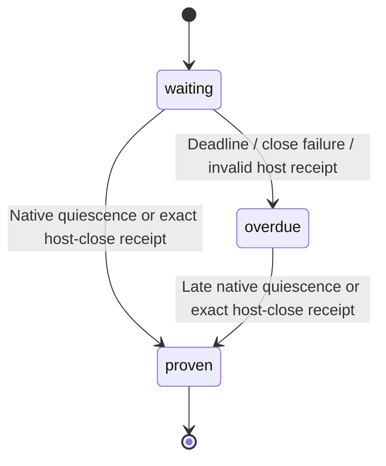

# Uncertain worker effect drain

This unit follows the qualified scoped request/channel composition. The user
authorized continued implementation and testing while away. Native lock ownership,
account transforms and consumer-specific selection/migration stay with callers.

An account owner needs execution-quiescence evidence before releasing its Web Lock
after an uncertain WRITE. `createWorkerEffectDrain()` observes the original native
settlement receipt and the exact independent host-close receipt. It posts one close
command through the existing channel; the channel coalesces repeated close commands
and never replays a write. There is no write, transform, lock-release or SDK capability
in this helper's input.

A known native acknowledgement or definitely-not-issued result may be classified as
`settled`. An RPC rejection/timeout without execution evidence is `uncertain`;
rejecting that observer promise does not prove quiescence. Uncertain/rejected native
receipts leave the independent host receipt active. Close failure and deadlines
report overdue without discarding either pending receipt. A stale scope or close ID
cannot release custody. Earlier unknown operation output stays unknown after proof;
the output authorizes resource drain only, never success, rollback or replay.

The owning account chart retains native receipts on forced stop and hands them to a
longer-lived custody owner. A replacement drain chart may observe those same receipts;
it cannot issue the original effect. Stopping this helper produces no proof and
executes no resource release. Actual realm termination remains the host protocol's
responsibility.

## Qualification

16 drain tests pass, including uncertain/rejected settlement, wrong scope/close ID,
close-post/host-observer failure, invalid deadlines, both proof orders, forced stop
and observation of the same original receipts by a replacement custody owner.
An independent receipt ledger runs 300 generated sequences (seed 20261114,
up to 16 commands), with full contract-model event/state/transition coverage.
This is bounded sampled evidence, not exhaustive scheduling proof.

356 tests in 15 lifecycle/workspace/scoped-form-binding files pass. Strict targeted
TypeScript, library checks (zero Svelte errors/warnings), package/strict publint,
public consumer checks/builds, formatting, lint and whitespace checks pass.
The public package fixture invokes the drain chart from a typed parent holding an
actual native Web Lock. An uncertain result and expired deadline leave one held
lock and a competing pending request. Only the matching scoped close receipt
permits the parent to release; it awaits actual native release before completing.
The fixture proves this composition, not Clipper/Finance account-owner adoption.

No write, transform, lock-release capability or implicit retry is added. Clipper's
native control adapter is qualified independently; its account owner and the
consumer artifact still need integration and qualification before request deadlines
are enabled for production writes.
