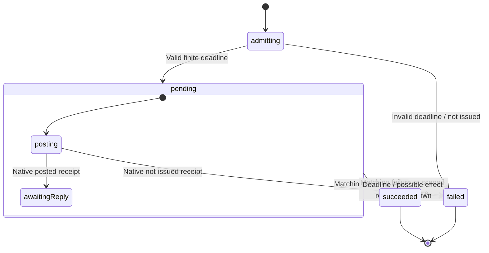

# Scoped worker request lifecycle

This is B's first implementation unit: one correlated native request. Channel
admission, concurrent request routing, Window adapters and account-lock ownership
remain separate owners. No consumer is migrated by this unit.

## Reviewed consumer pins

- Clipper `71cdd08008cc0f79bbe1f94d67d94ad401f8fbb5`, `feat/workflow-hardening`: account-store, storage-channel,
  broker-channel and their Window compatibility leaves.
- Finance `1125c5f1dc3d99c484988b6c4053e5d25526a45a`,
  `xstate-v6-worker-runtime`: host protocol/client/drain/Window host,
  account-store operation/lock/owner and SDK facade. The worktree was clean.
- DLF `561699d`, following the qualified shared transaction/supervisor work.

| Concern              | Clipper pin                       | Finance pin                                            | Shared contract                                                                       |
| -------------------- | --------------------------------- | ------------------------------------------------------ | ------------------------------------------------------------------------------------- |
| Correlation          | UUID per call; fixed private port | Scope UUID, request UUID and monotonic sequence        | Match scope, request ID and sequence; a new binding gets a fresh scope.               |
| Request bounds       | No reply deadline/capacity bound  | Eight concurrent requests, 10-second deadline          | Per-request finite deadline; channel admission retains the eight-request bound.       |
| Failed posting       | Rejected promise                  | Definitely not issued when native posting fails        | Accept a specific not-issued native receipt; unexpected failure remains conservative. |
| Lost write reply     | Generic failure; lock may release | Unknown write; retain lock until host closure          | Report unknown execution, never success/rollback or permission to replay.             |
| Host closure         | Data-port disposal                | Separate scoped control port with actual close receipt | Disposal/timeout is not a host-close receipt.                                         |
| Returned broker port | Close unmatched `OPENED` port     | Close malformed, stale, extra and unmatched transfers  | Native channel adapter releases all unclaimed transferred resources.                  |
| Account selection    | Clipper v1/v2 storage keys        | Finance selection/inventory/legacy cleanup policy      | Existing namespaces and consumer-specific migration stay local.                       |

## Closure and write-settlement handshake

Specify the full composition before adopting the request primitive:

1. The worker root creates an immutable channel scope. Its channel owner validates
   protocol messages and admits bounded requests with unique IDs and increasing
   sequences. Register correlation before posting; request startup must not race
   ahead of registration.
2. A request owner posts the selected operation once and awaits a matching decoded
   reply. Native leaves report either posted or definitely not issued. A thrown
   leaf, lost transport or expired reply deadline may follow an issued effect.
3. Request failure settles its observer once. An account operation receiving an
   unknown write result retains its Web Lock and original transform/result facts;
   it neither reapplies the transform nor admits another update under that lock.
4. The root requests `CLOSE_HOST` over an independent scoped control capability.
   Window removes the old data-port handlers and closes that data port before
   acknowledging `HOST_CLOSED`. Its storage primitives are synchronous, so no
   queued write can execute after that disposer returns. The receipt proves
   quiescence, not whether a prior write committed.
5. Only the exact original scope's closure receipt permits releasing retained
   custody. A close timeout/error keeps the independent late-receipt listener
   and lock custody alive. A later receipt can complete drain without changing
   the original request's failed/unknown result. A replacement account binding
   cannot use another scope's receipt.

This preserves Finance's stronger boundary. Clipper's existing READ/WRITE ports
need that control handshake before account writes adopt request deadlines. A
generic request timeout alone is insufficient. Finance selection and legacy
scrubbing are not promoted into DLF by this work.

## Request chart and typed boundary

`createWorkerRequest<Request, Response>()` receives one immutable identity,
selected query/effect payload, finite deadline and native post capability. Wire
schemas remain protocol-specific; they validate/decode before sending `REPLY`
or scoped `TRANSPORT_FAILED` reports to this actor. There is no MessagePort,
SDK schema, account key, generated identity or root actor hidden in the helper.

The adapter classifies broker opening as an effect because it allocates a native
resource, even though it does not write account storage. Generation/account writes
are effects too. Only operations without mutation or resource allocation are
queries; this discriminator is a selected native capability fact, not a retry mode.

The pending state accepts a valid matching reply even while posting is settling,
so an early reply cannot be lost. Its deadline covers both posting and reply wait.
Mismatched correlation and old-scope transport reports do not settle it. A query
has no mutation; effect failure is unknown unless the native/peer boundary supplies
a definite not-issued receipt. The actor returns the original identity and exact
successful response; failed results contain bounded reason/disposition facts.
Terminal entries clear the request payload and post capability. Native handles,
functions and credentials are not persistent XState checkpoints.

The channel owner remains responsible for source/protocol validation, capacity,
registration, routing, malformed replies and closing orphaned transferred ports.
The account operation remains responsible for locks, issued-write custody and
the independent closure handshake. Forced request stop does not acknowledge any
of those resources. The primitive does not advertise cancellation of a posted
write, allocate retries, close a channel, or select account identity.

## Review and qualification

Strict source TypeScript and declaration emission, library checks (zero Svelte
errors/warnings), packaging with strict publint, formatting, lint and whitespace
checks pass. The implementation uses the pinned beta's enclosing state
`timeout`/`onTimeout` boundary; no timer promises or procedural retries are added.

The user approved testing this implementation with “Continue” after its source
review. Qualification now passes:

- 33 request tests cover exact identity/response preservation (including undefined
  responses), pure `can()` evaluation, immutable prior snapshots, payload clearing,
  early replies, post failures, definite not-issued receipts, query disposition,
  stale correlation, scoped transport failure, timer limits, both deadline-race
  orders, duplicate/late reports and forced stop without a fabricated receipt.
- The independent external request ledger uses `@xstate/test` against the real
  actor and `SimulatedClock`: seed 20261112, 300 runs, up to 16 commands per run.
  Generated success/rejection, identity mismatches, transport loss and elapsed-time
  sequences reach 100% of the contract model's event, state and transition
  coverage. This bounded campaign exercises posted effects; targeted tests cover
  posting races and query/native-failure classifications. It is not exhaustive
  browser scheduling or native resource qualification.
- 312 tests in 13 files pass across lifecycle, workspace and scoped-form-binding
  regressions. Strict targeted test TypeScript, changed-source lint, formatting
  and whitespace checks pass.
- `check:library` reports zero Svelte errors/warnings; `package` passes strict
  publint. `check:consumer` passes declarations, existing fixture checks/builds
  and a new public-import parent invocation across A → B → A scopes. That fixture
  verifies exact payload delivery, stale-scope rejection, output identity and
  response typing without private actor imports or casts.

The request implementation required no behavioral changes during qualification.
The public consumer fixture groups its related values into one immutable context
record to satisfy the pinned beta's context compatibility rules. No consumer or
Clipper archive adopts this request helper yet. The channel owner and independent
close-receipt composition are the next implementation unit; both pinned consumers
and actual Window/Web Lock adapters still require qualification before adoption.
SHARE-3, REC-3 and DLF-3 remain open.
