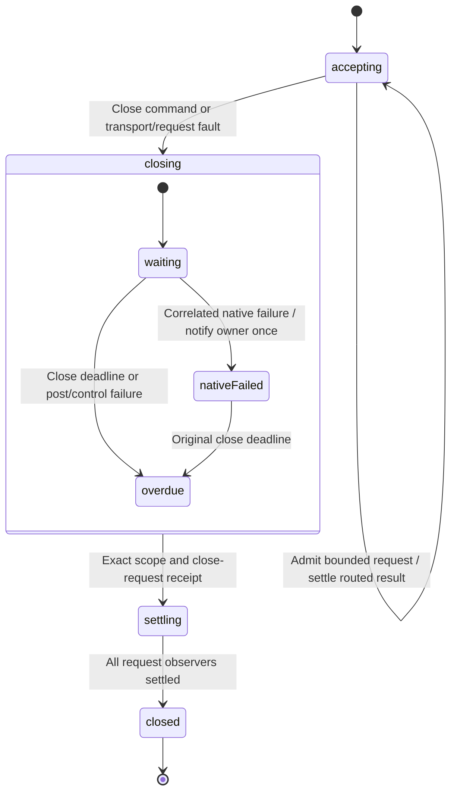

# Bounded worker channel ownership

The user authorized the original channel implementation and tests while away.
The PR #35 native-failure correction received separate concrete implementation
and test approval on 2026-11-14; see its [review and evidence](worker-host-close.md#pr-35-review-correction-explicit-native-failure-facts).
The consumer pins and closure design in `worker-request.md` remain authoritative.

The parent invokes one channel per immutable host scope. Its private controller
invokes native data and independent control listeners. It admits up to eight
requests, assigns monotonic sequence numbers, registers each spawned request and
its outcome subscription before the queued post can execute, and rejects excess
or duplicate active IDs without posting. The public protocol is `REQUEST` and
`CLOSE`; child and adapter reports stay behind the controller boundary.

Each request invokes the qualified request chart. Native decoded replies match
all identity components and a pure operation-specific response predicate.
Unclaimed success responses are discarded through the injected native resource
capability, including duplicate or late broker ports. A delivered successful
response belongs to its observer; an observer throwing during delivery causes
that response to be discarded. No workflow or retry is hidden in that callback.

Closing refuses new work, fails pending observers conservatively and posts one
host-close request. It never replays requests. A close deadline or generic
post/control failure reports overdue. A correlated `HOST_CLOSE_FAILED` retains
the first native disposal/acknowledgement fact and notifies optional
`onCloseFailure` once. It enters `closing.nativeFailed` while preserving the
original close deadline, or stays overdue if that deadline already passed.
Neither failure path releases the independent listener or produces channel output.
Only the exact original scope and close ID can produce a closure receipt. The
original unknown-write result is unchanged by a later receipt. Parent account
operations may use that real receipt to release retained lock custody. Stopping
the actor or disposing its listeners is not closure evidence.

Native listener setup and posting are individual leaf operations. Their adapters
perform bounded validation and resource cleanup; they do not choose account
identity, migration, SDK transforms, retries or lock release. The protocol adapter
must prevent queued data-port effects before sending a close receipt. Channel
errors cannot manufacture a receipt; unexpected controller failure reports
blocked so the parent retains custody.

No account namespace or storage schema changes. No consumer adopts this chart
until public package checks and real adapter tests pass.

## Original channel qualification

- 28 targeted channel tests pass. They cover eight concurrent requests, overload,
  duplicate IDs, out-of-order and early replies, wrong response kinds, stale and
  duplicate transferred resources, posting failures, transport loss, observer and
  predicate failures, close deadlines, wrong/late receipts and forced-stop cleanup.
- The independent external ledger runs 400 generated sequences (seed 20261113,
  up to 24 commands), with complete contract-model event/state/transition coverage.
  This is bounded sampled evidence, not exhaustive native scheduling proof.
- 340 tests in 14 lifecycle/workspace/scoped-form-binding files pass. Strict test
  TypeScript includes exact optional-property checking. Library checks report zero
  Svelte errors/warnings; packaging passes strict publint. Formatting, changed-source
  lint and whitespace checks pass.
- The public package fixture invokes the channel from a typed parent. Real Node
  MessageChannels prove transfer cleanup, a lost acknowledgement after a genuine
  write, conservative unknown output, one close post, continued listening after a
  close deadline and completion only on the original scoped receipt. Public types
  reject forged wire, child-completion and host-close reports.

The native data callback retains both observer and unclaimed-response custody.
Queued registration precedes native posting. Graceful settlement removes each
observer once; forced stop fails remaining observers conservatively and releases
unclaimed response resources. Listener disposal still produces no host-close
receipt. A successful observer delivery transfers response custody before invoking
consumer code, so a consumer stopping its parent does not close an accepted port.
Admission refusal has its own `refused` result with no fabricated wire sequence.

Production review caught exact-optional-property compatibility in slot records;
qualification also corrected blocked-channel refusal to report unavailable. The
fixture enforces bounded native waits. Existing account operations and consumer
archives remain unchanged; actual Window adapter/Web Lock qualification is still
required before Clipper or Finance adoption.

Native channel post receipts are restricted to posted or unavailable/not-issued.
Payload validation belongs before channel admission, so a local refusal cannot
consume a sequence and leave a healthy FIFO host expecting the missing number.
An unavailable native post closes the channel; a decoded peer rejection consumes
its posted sequence and can preserve healthy admission. This retains Finance's
strict sequence boundary without weakening native execution evidence.
