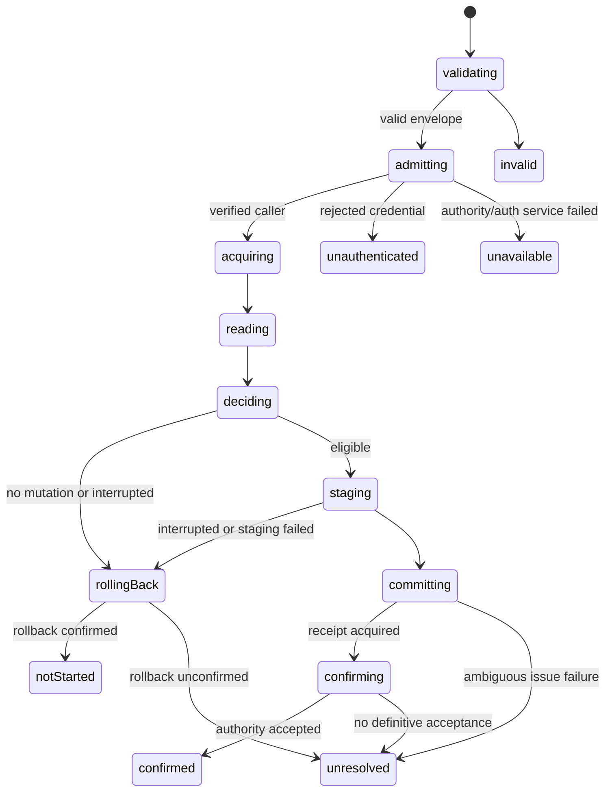

# Invitation authority: admission and native transaction boundary

> Current status: client (33), adapter (18), owner (71), and native permission (15) tests pass.
> These qualify distinct boundaries, not end-to-end invitation redemption. See
> [native storage](native-storage.md) and [remaining tasks](../../tasks.md). Earlier review gates
> below record the sequence of implementation and qualification.

## First backend review scope

The client operation and 32 tests are committed as dabf818. This task adds authenticated admission
and native transaction leaves, before implementing the redemption resource owner. It does not add
an endpoint, schema, membership mutation, deployment or browser dependency on backend credentials.

Pinned evidence: Jazz 2.0.0-alpha.59, `backend/create-jazz-session.{d.ts,js}`,
`backend/create-jazz-context.js`, `runtime/db-access-context.js`, `runtime/db.d.ts` and
`runtime/client.d.ts`. The SDK's attributed database uses the verified request session as write
provenance and exposes it through getAuthState while retaining backend read authority. Therefore one
withAttributionForRequest call supplies both the verified account and the transaction database; do
not call forRequest separately and do not trust an account ID submitted by the client. Only public
SDK APIs are used; internal files above are inspection evidence, not imports.

Reference: [Jazz invite links](https://jazz.tools/docs/recipes/access-control/invite-links). Its
exclusive-transaction recipe is the native basis, not copied procedural orchestration. Our resource
owner must expose its read/decision/write/settlement steps as states. Runtime isolation, concurrent
redemption and exact pinned-SDK behavior still require approved qualification.

## Ownership tree and sequence

Host-owned ready backend session
-> per-request redemption owner
-> one attributed request scope (no new session)
-> one exclusive transaction owner
-> acquisition / read / decision / staging / commit / confirmation / rollback leaves.

Planned statechart:

Acquisition is drained on cancellation: retain the acquired handle, then roll it back. During reads
and staging, retain the resource until the leaf finishes; skip commit and roll back on interruption.
Once commit is invoked, drain it and confirmation without asserting cancellation undid the write.
The actual resource-owning machine must encode these transitions before any caller uses these leaves.
Raw actor.stop, aborting an HTTP response and locally staging a membership are not proof of rollback
or authority acceptance. A request that cannot return confirmation must cause the client to retain
unknown settlement, not an automatic replay.

## Implemented admission leaf

Capture only the incoming Authorization value into a fresh frozen request-header record before
awaiting SDK admission. The adapter never reads the body, invitation code, client-supplied principal,
URL or cookies. Supported input is a server Request/Headers surface with a bearer credential.
Delegate credential verification/admission once to the existing backend client. Missing, malformed,
expired or rejected credentials become unauthenticated; non-authentication errors become unavailable.
No raw exception or bearer is returned. A missing verified account on the attributed Db also fails
closed. This is one SDK admission effect plus boundary projection/error normalization, not a hidden
read/check/write workflow. Do not attach raw input/actor diagnostics to bearer-bearing request flows.

The host owns the ready backend client and shutdown. Per-request attributed scopes share the native
backend runtime; do not close the database or replace its session on request completion. Once
admitted, only the verified account ID and transaction capabilities cross this boundary. No request,
bearer or full database is returned; the transaction opening closure retains its attributed scope.
Release those capabilities when the future request owner finishes.

## Implemented transaction leaves

The attributed Db's beginExclusiveTransaction acquires the resource. commit issues exactly one
native commit and returns an opaque receipt envelope. confirm waits on ExclusiveWriteHandle.wait()
without a local/global tier argument: acceptance belongs to authority. rollback delegates exactly
one rollback request and returns the native boolean. None of these functions starts actors, reads
rows, decides eligibility or stages membership data. Read/schema/stage mappings remain server-side
app integration; the transaction owner will choose when to call each leaf.

The boolean rollback result must be checked by the owner. Rejected rollback or false cannot be
reported as a definite no-write result. A successful exclusive confirmation and ordinary local
persistence are different contracts; never substitute a local durability wait here.

## Next resource-owner contract and policy qualification

Read the invitation and membership/redemption evidence in one transaction. Classify the verified
caller's existing membership before creating another. Validate secret, revocation and single-use
status without exposing a protected workspace to an unrelated requester. Define expiry against a
trusted service clock with an explicit check-time rule, not the browser clock. Stage membership and
single-use consumption/evidence atomically; no role comes from the redemption body. Non-secret
operation evidence must support authenticated reconciliation after a lost reply, including after
membership removal; do not use an old idempotency record to silently restore access.

The next implementation must fix the exact schema/decision contract before writing storage effects.
Qualification must cover the pinned transaction read tier, concurrent redeemers, clock boundary,
revocation, caller attribution, missing/bad bearer, unavailable admission, unrelated identity denial,
replay after membership removal and commit/rollback uncertainty. A generic leaf adapter is not
proof of storage policy correctness or a completed invitation feature.

## Current review gate

Only this boundary is implemented. Static checks/package declarations may run before review;
implementation tests wait for review under AGENTS.md. Affected coverage after approval: one admission
per request, immutable credential capture, same-Db identity/transaction scope, no new session/close,
authentication versus availability classification, no credential/error leakage, and native receipt,
confirmation and rollback delegation. No native-policy or concurrency success is claimed yet.

## Static implementation review

The adapter and actor-free capability contract are implemented under
`backend/jazz/invitation-authority` and `workspace/invitations/authority-contracts`. Strict TypeScript,
focused lint/format checks, declaration packaging and strict publint pass. No implementation tests
were added or run for this unreviewed boundary. The previously verified client is unchanged.
The next cycle qualifies these leaves before composing the resource-owning redemption statechart.

Native source inspection also confirms explicit exclusive acquisition requires a created client;
the host must supply its ready backend client. Do not warm or create an unrelated user session,
perform an app-startup authority query, or copy an SDK transaction callback to bypass this boundary.

## Qualification after implementation review

The user instructed continuation after the admission/transaction implementation review. All 18
focused adapter tests pass. The native fixture uses a separate permissive notes schema, disposable
Jazz policy server and public SDK database/transaction objects; it does not define the future
invitation schema. It confirms an exclusive write at authority, observes its persisted value and
confirms rollback leaves no inserted record. Delegation preserves the native receipt, tierless wait,
false rollback, and acquisition/commit/confirmation/rollback errors for the resource owner.

Admission tests cover lazy construction, one verification per request, unchanged body input,
verified-database identity instead of a forged body ID, frozen credential capture, separate concurrent
request headers, missing/rejected/malformed/expired credentials, cross-copy SDK authentication
errors, unavailable admission, absent verified session and capture failure. No database shutdown or
transaction opening occurs during admission, and no credential or raw exception is in the result.

Request admission is stubbed at the native `withAttributionForRequest` method. This verifies adapter
projection/delegation, not actual bearer cryptography, registry admission or invitation authorization.
Those remain integration qualification tasks with the actual endpoint and invitation policy.
No production implementation change was needed for the approved adapter tests.

The built server-only public consumer constructs the adapter without side effects, invokes one
admission and checks its sanitized failure. Public consumer types/execution, strict source types,
focused lint/format, declaration packaging and strict publint pass. The consumer imports no direct
Jazz API; native imports remain in the backend adapter. No Finance/UI/localization changes or
ordinary startup network preflight are introduced. Next is the resource-owning redemption statechart
and the exact native invitation/membership/evidence mapping described above.
