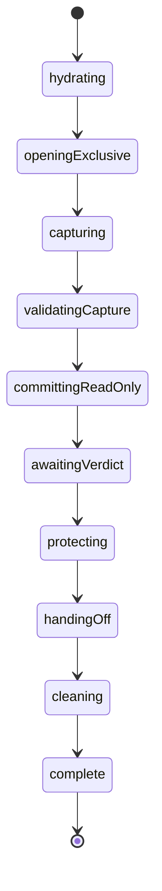

# Shared workflow and resource contract

The public factory APIs will be typed from this protocol during implementation; this document does not pretend an unreviewed full TypeScript signature is final. Pure archive handling and stateful lifecycle exports are separate. No Finance or Jazz types appear in the shared profile contract.

The test app reference implementation now supplies complete sequencing in
`fixtures/test-app/restore-workflow.ts`. Shared `backup/restore/workflow` owns one selected
journaled write, including activation, with consumer-owned finite destination actors. The test app
root coordinates planning, all mapped writes, complete content comparison and activation without
moving its domain schema or policy into the foundation. See
[completion design and qualification](../restore-completion-design.md).

## Actor ownership

Consumer integration owns the existing session binding, access observations, browser file input/download effects, and the lifetime of one backup operation. DLF owns the generic export/inspection/restore coordinators. Consumer capture and destination adapters are child actor logic where they have multiple meaningful steps, not promise functions hiding a whole workflow. Promise actors may perform one bounded leaf operation (one read, one digest, one journal lookup).

Resource owner children hold passwords, keys, decoded bytes, file handles, and native capture transactions privately. Parent context holds only opaque resources and safe progress. Neither parent nor child persisted snapshots may contain secrets or decoded records; persistence serializes only the explicit restore journal. This is a persistence boundary, not a claim that JavaScript memory can be reliably zeroized. Clear references and worker resources on release; strings and Web Crypto internals may remain until garbage collection.

## Profile responsibilities

The profile supplies exact ID/version and codec validators; authorized capture logic; domain graph validation; destination preparation/restore logic; authoritative reconciliation; recovered-content comparison; activation; and incomplete destination reporting. Each operation observes the bound generation and reports structured non-sensitive failures. Caller-supplied logic follows the same machine-first/resource ownership review as shared code.

A validated archive has no write authority. Before new writes the destination logic rechecks current authority and archive/profile binding. Capture ownership and restore authority are different capabilities.

## Export statechart

The sole native Jazz export workflow is `createJazzArchiveExportMachine` at
`backup/export/workflow`. Prepare its request through `backend/jazz/backup`. Shared restore/export
binding validation and equality are at `backup/binding`. The former generic source/lease protocol
and retry-cleanup machine are removed.

The consumer reader covers the full scope during hydration and capture and owns domain/owner/byte
validation. DLF owns the native transaction and issued query/digest/verdict receipts. Only a positive
zero-application-mutation exclusive verdict reaches protection/handoff. Failed captures are discarded;
explicit retries begin with new hydration and a fresh transaction.

Cancellation, invalidation and child failure revoke reader capabilities, clear private inputs and
enter cleanup. Cleanup drains issued native calls and rolls back only an uncommitted transaction.
A committed receipt is observed, never rolled back or replayed. Offline cleanup can remain pending
until native work settles. A direct resource custodian also survives abrupt owner/reader errors.
Handoff reports dispatch, never retained-file safety. See [native capture](native-capture.md).

## File inspection statechart

Selecting → bounding input → parsing header → requesting password when needed → authenticating → validating generic payload → validating recognized profile → reporting → releasing. Repeated password attempts do not write destinations. Cancellation during native cryptography can discard eventual results, but cannot claim the underlying call stopped. Worker termination is explicit resource cleanup where used.

## Restore statechart

Validated immutable resource → checking destination authority → finding or creating operation journal → preparing isolated destination → reconciling batch → staging batch → committing → waiting for global settlement → advancing progress → comparing actual destination contents → activating → reconciling activation if unknown → verified complete.

A write resource owner models acquisition, staging, commit, confirmation, rollback when possible, and unknown outcome. After commit/cancel or access loss, it drains issued calls and preserves operation identity; parent cancellation does not blindly exit the owner. Before issuing any later writes, settle or classify the current write. Absence is conclusive only through a qualified authoritative read at the expected IDs; otherwise return unresolved incomplete. Conflicting content stops restoration; no automatic overwrite.

Batch size is deterministic and bounded by record/byte budgets. Relation cycles and graph groups requiring atomic policies are profile-owned transaction plans; batching cannot split atomic invariants merely to fit a generic loop. Phase transitions are states, not an async loop hidden in a promise actor.

## Events and reports

Consumer commands: start export, inspect file, supply password, start/resume restore, cancel, request drain. Observations: binding/access invalidated, dependency failed, global confirmation/rejection, file handoff result. Child reports carry generation plus operation identity and typed settlement. Public views expose progress stage, counts, localized message descriptors, recovery operation reference, and actionable errors, never passwords, decoded records, private file names in telemetry, or child state paths.

Graceful shutdown: stop new work → ask active write owners to drain/reconcile → retain incomplete journal → release capture/file/crypto resources → acknowledge → stop. Closing a dialog cannot undo a committed write. Retry navigation/file download independently of already successful data operations.
