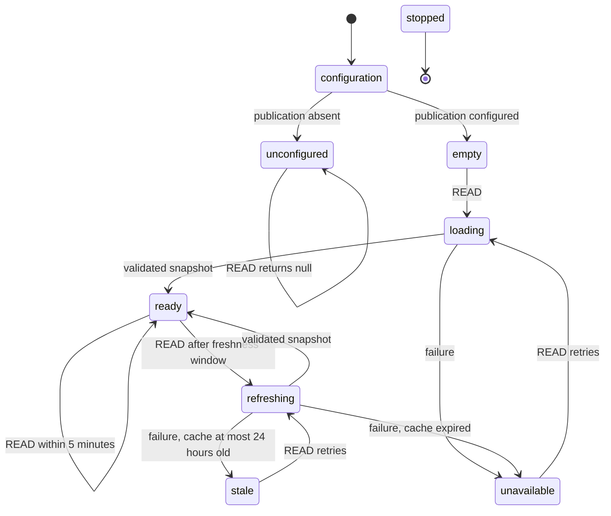
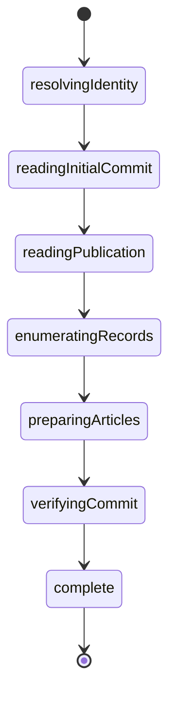

# Reader lifecycle — XState v6

The reader uses exact dependency `xstate@6.0.0-beta.1`. It follows the installed
package's v6 contracts: `schemas`/`types`, `createAsyncLogic`, transition context
patches, and queued effects. It does not use v5 `assign` or `fromPromise` APIs.
Sources: bundled `node_modules/xstate/docs/agents.md`, `async-requests.md`,
`transition-functions.md`, and `cancellation.md`.

`STOP` from any active state goes to `stopped`, rejects all waiting callers, and
aborts the invoked async actor. Late completions cannot replace the cache.

## Responsibilities and invariants

- `reader.ts` is the Promise API adapter. It validates configuration, starts the
  actor, sends read events, and disposes it. It holds no separate pending promise
  or snapshot cache.
- `reader-machine.ts` owns the local snapshot, waiting callers, and refresh lifecycle.
  Concurrent reads share one invocation. Success/failure replies are queued
  effects, executed after the transition commits; waiting callers are cleared.
- Transition calculations do not read the clock. Read requests carry their time,
  and failed async work records its completion time outside the transition. Cache
  expiry is checked again after a failed refresh, so an old request cannot serve
  content that expired while it was waiting. No resident aging timers are needed.
- `load-snapshot.ts` coordinates a complete archive read; identity, RPC,
  pagination, article conversion and schemas live in separate focused modules.
- `schemas.ts` validates upstream JSON with Zod before filtering publication
  membership. Missing site/type/envelope/cursor data fails the scan. A malformed
  response cannot successfully replace the archive with an empty result.
- Only a completely validated, unchanged-repository scan replaces the snapshot.
  A stale response retains the last successful verification timestamp. Failure
  after 24 hours rejects instead of returning the expired body.
- Runtime upstream validation is separate from the machine's type-only schemas.
  The actor contains callback/function references and is not persisted. Durable
  storage contains validated plain snapshot data, not actor checkpoints.

`PublicationReader.stop()` is idempotent and must be used for production disposal
so queued callers are settled before the actor ends. Development hot reload disposes the previous reader; deployment environment
values remain fixed for the process lifetime.

## Verification

`tests/reader-machine.test.ts` checks states and externally observable results:
unconfigured reads, initial loads, concurrent callers, fresh hits, refreshes,
stale failure/recovery, expiry during a pending refresh, retries, cancellation,
cleared waiters, and ignored late results. `tests/reader.test.ts` checks the actual
loader and the missing-site/malformed-envelope regression.

## Snapshot loading stages

`load-snapshot.ts` owns one short-lived `snapshotMachine` actor per refresh and
bridges the reader's abort signal to that actor. The machine invokes one stage at
a time; each asynchronous stage owns its transport cancellation signal.

Any stage error terminates the load and propagates the original error to the
reader's refresh lifecycle. Cancellation aborts the current stage and rejects the
load without starting later stages. No intermediate result becomes a snapshot.
The final stage checks the repository commit before assigning `verifiedAt`.
A single 40-second deadline aborts the complete load, including an in-flight
request, independently of the per-request timeout. Pagination and article preparation remain focused functions;
the machine coordinates their lifetimes rather than modeling each record as a
state. No automatic stage retries or partial-scan resumption are introduced.

Tests cover ordered completion, failure at every stage, and cancellation at every
stage (including blob loading during article preparation).

`preparingArticles` prepares metadata and
hydrates content blobs into the package document input; the package performs
block and inline normalization when rendering. The lifecycle is unchanged.

Each snapshot stage declares its required context using v6 state schemas.
Transitions must provide missing results before entering the next stage; actor
inputs need no non-null assertions for prior-stage output.

## Durable mode

When a store is supplied, every READ invokes the durable loader even if the
process copy is fresh. Successful stale fallback enters the explicit stale state.
The machine disables local error fallback in this mode; the durable loader alone
chooses a current stored snapshot. Concurrent callers in one process still share
one invocation. Independent instances may scan concurrently; no distributed lock
or background job is needed.

1. Read the current private Blob with `useCache: false`. If its original
   `verifiedAt` is less than five minutes old, return it.
2. Otherwise perform a complete AT Protocol scan with the existing 40-second
   deadline. A successful scan replaces exactly the ETag read before it started.
   Initial creation forbids overwrite. Each write includes a unique revision to
   avoid reusing an old ETag for an identical body (ABA).
3. A failed write/scan or losing CAS re-reads current storage. Discard the losing
   scan. Return the stored winner only while its original verification age is at
   most 24 hours. Never advance verification time during fallback.
4. If storage is unreadable, missing after failure, invalid, from another scope,
   or outside the allowed age, return unavailable. Do not resurrect the process's
   old copy. Cancellation never becomes a stale success.

One versioned JSON object holds the complete inventory, so deletion and body
changes commit together. Stored schema version, publication/owner/namespace,
article identities, paths, dates, URLs, duplicate keys, and a 10 MB read/write
limit are checked. A complete empty snapshot is an authoritative removal.
Storage operations have four-second abort limits; the source scan retains its
40-second total deadline. Publication verification remains configuration-only.

Keys hash schema version, publication identity, and environment/branch scope.
Production uses a separate namespace; Preview keys include the branch, not its
commit SHA, so redeployments retain snapshots. This is application namespace
isolation; use a separate private Production store at cutover. No CDN/ISR or
Runtime Cache layer extends freshness.

Tests in `durable-loader.test.ts` and `blob-store.test.ts` exercise cold readers,
shared reads, concurrent first creation, deletion races, storage errors, CAS
preconditions, bounded stale/future times, cancellation, validation, and isolation.
Blob consistency/conditional-write behavior follows the
[SDK contracts](https://vercel.com/docs/vercel-blob/using-blob-sdk).
