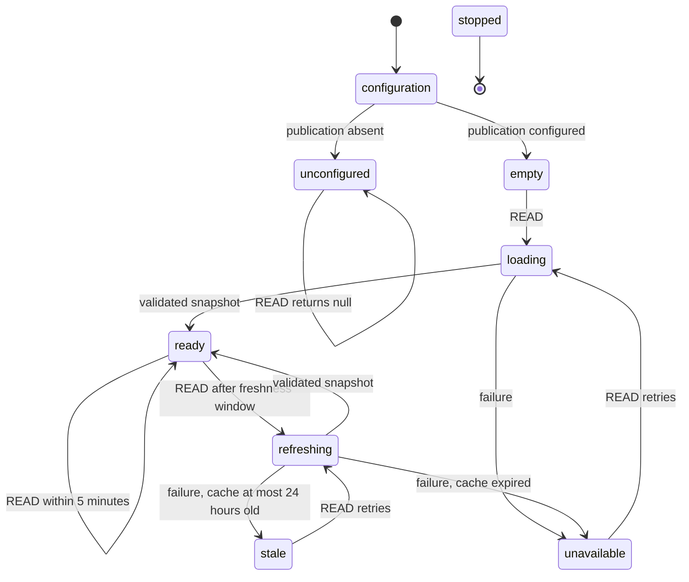

# Reader lifecycle — XState v6

The reader uses exact dependency `xstate@6.0.0-beta.1`. It follows the installed
package's v6 contracts: `schemas`/`types`, `createAsyncLogic`, transition context
patches, and queued effects. It does not use v5 `assign` or `fromPromise` APIs.
Sources: bundled `node_modules/xstate/docs/agents.md`, `async-requests.md`,
`transition-functions.md`, and `cancellation.md`.

`STOP` from any active state goes to `stopped`, rejects all waiting callers, and
aborts the invoked async actor. Late completions cannot replace the cache.

## Responsibilities and invariants

- `reader.ts` is the Promise API adapter. It validates configuration, starts the
  actor, sends read events, and disposes it. It holds no separate pending promise
  or snapshot cache.
- `reader-machine.ts` owns the cache, waiting callers, and refresh lifecycle.
  Concurrent reads share one invocation. Success/failure replies are queued
  effects, executed after the transition commits; waiting callers are cleared.
- Transition calculations do not read the clock. Read requests carry their time,
  and failed async work records its completion time outside the transition. Cache
  expiry is checked again after a failed refresh, so an old request cannot serve
  content that expired while it was waiting. No resident aging timers are needed.
- `load-snapshot.ts` coordinates a complete archive read; identity, RPC,
  pagination, article conversion and schemas live in separate focused modules.
- `schemas.ts` validates upstream JSON with Zod before filtering publication
  membership. Missing site/type/envelope/cursor data fails the scan. A malformed
  response cannot successfully replace the archive with an empty result.
- Only a completely validated, unchanged-repository scan replaces the snapshot.
  A stale response retains the last successful verification timestamp. Failure
  after 24 hours rejects instead of returning the expired body.
- Runtime upstream validation is separate from the machine's type-only schemas.
  The actor contains callback/function references and is not persisted; durable
  snapshots and coordination across Vercel instances remain a later integration.

`PublicationReader.stop()` is idempotent and must be used for production disposal
so queued callers are settled before the actor ends. Configuration replacement
and development hot reload dispose the previous reader.

## Verification

`tests/reader-machine.test.ts` checks states and externally observable results:
unconfigured reads, initial loads, concurrent callers, fresh hits, refreshes,
stale failure/recovery, expiry during a pending refresh, retries, cancellation,
cleared waiters, and ignored late results. `tests/reader.test.ts` checks the actual
loader and the missing-site/malformed-envelope regression.
