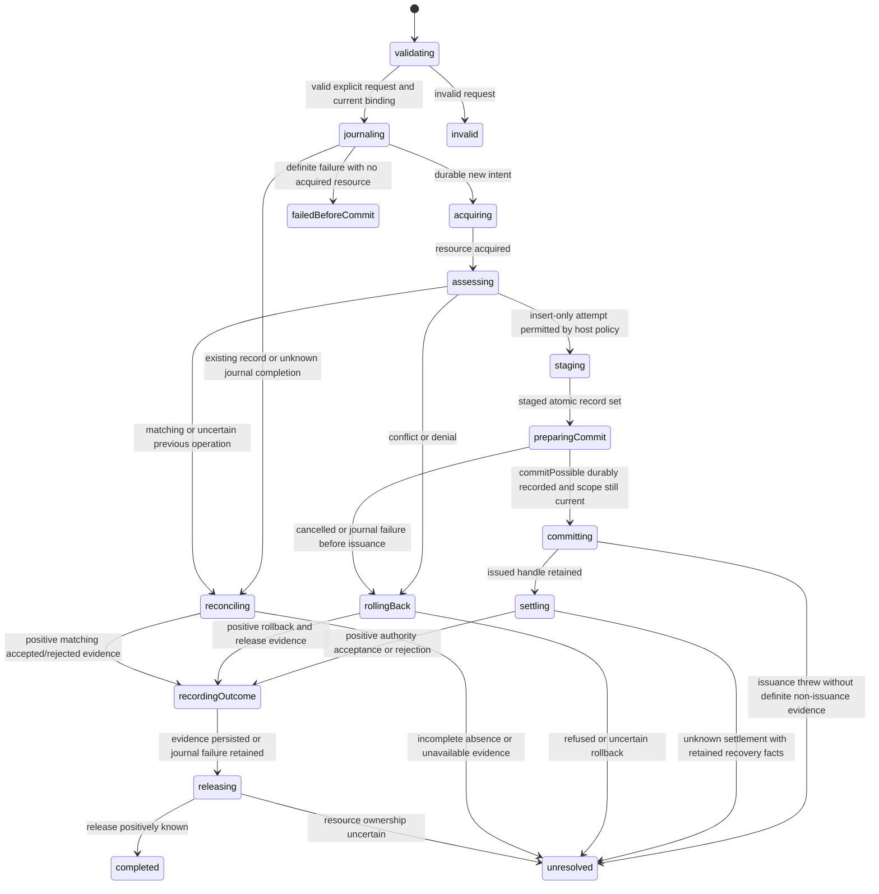

# Private creation workflow and durable journal boundary

> Supplemental qualification and internal journal work. The merged local-first creation workflow
> and extracted journal remain governed by [creation/plan.md](creation/plan.md), the
> [current delivery ledger](../tasks.md), and their public package entries. This proposal does not
> replace them, impose authority waits on ordinary creation, or authorize a consumer migration.
> Design-history references below to an unbuilt owner concern this supplemental integration;
> they are not the status of the already shipped creation capability.

Status: internal contract, statechart and browser journal adapter implemented; sixteen approved journal
checks pass in Chromium. No creation workflow or new public package export is introduced.
The internal actor-free types live in `src/lib/contracts/workspace-creation-journal.ts`.

## Qualified starting point

The isolated Jazz fixture qualifies configured-authority exclusive confirmation, a concrete
insert-only collision policy, and matching-record recovery across Chromium process termination.
It does not establish authoritative absence from an empty query or a historical transaction-fate API.
The first adapter proposal therefore returns authority acceptance for new creation, and unknown when
positive reconciliation evidence is missing. This does not adopt an online-only consumer onboarding
policy or change an existing consumer's offline requirements.

## Journal identity and persistence

A journal key comprises host ID, authenticated account ID and stable operation ID. The immutable
record additionally stores intended workspace ID and the normalized request fingerprint. It contains
no root credential, SDK resource, live binding token or domain payload. Generation and opaque
attachment tokens belong to a fresh live scope, not to persisted authority evidence. A restored
session must verify the journal account and explicit intent before resuming read-only reconciliation.

Allocate stable IDs and validate host input before journal insertion. Insertion is create-only and
must finish the real local persistence transaction before reporting persisted. Compare-and-set
advancement requires the entire fixed identity and exact revision, not only the operation ID. Reject
unsafe revisions, overflow, malformed identities, unsupported versions and invalid evidence
transitions. An existing record is not an idempotent write success; read it and reconcile its evidence.
Concurrent tabs cannot overwrite one another through last-writer-wins journal updates.

The journal exposes individual I/O leaves. The operation machine chooses transitions; a storage
adapter implements the atomic compare-and-set, validation and completion boundary. It must not create
workspaces, interpret missing database rows, retry mutations or hide transaction orchestration.
An unavailable write has unknown completion; re-read the same key rather than blindly advancing it.

| Previous durable evidence                                   | Permitted next evidence | Required live evidence                                                          |
| ----------------------------------------------------------- | ----------------------- | ------------------------------------------------------------------------------- |
| intent                                                      | commitPossible          | Current fixed scope and staged resource ready for one commit                    |
| intent                                                      | abortedBeforeCommit     | Commit never issued and owned resources positively released                     |
| commitPossible                                              | authorityAccepted       | Configured-authority confirmation or positively matched accepted records        |
| commitPossible                                              | authorityRejected       | Positively correlated authority denial/conflict, not an arbitrary error         |
| commitPossible                                              | abortedBeforeCommit     | Same live owner proves issuance never occurred and resource release is complete |
| authorityAccepted / authorityRejected / abortedBeforeCommit | none                    | Terminal evidence is immutable                                                  |

No transition returns to intent. Unknown outcomes preserve their last evidence. A corrupt record
cannot become missing, be deleted automatically or authorize a replacement operation. Storage
failures do not erase authority-confirmed results already retained by the live owner.

## Commit gap and restart rule

Persist `commitPossible` **before** issuing commit. A journal that still says intent after a restart
can otherwise conceal an already-issued write if issuance and its journal update were reversed.
The fixture explicitly exercises this interruption window without relying on a transaction ID.
The conservative pre-issuance record makes crashes before actual issuance unresolved too; safety
requires accepting that uncertainty. No missing row or journal timeout becomes replay permission.

A surviving live owner can distinguish cancellation before issuance and record abortedBeforeCommit
after positive release. A restarted owner has lost that resource evidence. It starts reconciliation,
not the mutation path. Even a recovered intent record does not automatically trigger creation: it
must be processed under deliberate host authorization and a separately reviewed retry policy.
No supported transaction-ID decoder or historical fate lookup is assumed by these initial types.

## Operation statechart and ownership

Session supervisor → creation operation owner → transaction resource owner. The operation owner
invokes journal leaves and retains authority evidence independently of journal failures. The resource
owner retains acquisition, staged transaction and issued commit handles through cleanup; it never
closes the session. The session supervisor owns rejection subscriptions beyond any foreground result.

This diagram shows work responsibilities. Cancellation/shutdown is a separate control region under
the same invocation lifetime; it must not exit and stop acquisition or commit promises. During
acquisition, retain a late handle then roll it back. During assessment/staging/journal persistence,
wait for the current leaf, prevent commit and release mutable resources. Once commit may have been
issued, cancellation cannot imply rollback. Retain settlement ownership and classify unknown fate.
All invocations require unexpected-error paths. Issuance throwing is unknown unless the adapter
positively proves it did not issue a mutation; promise rejection alone is insufficient.

The unresolved state in this diagram is a recovery result, not evidence that resources were released.
Before returning finite output, the resource owner must report either released, released-with-failure
or unresolved ownership; the supervisor keeps unresolved responsibility and cannot authorize an SDK
identity change from that output. It never waits for a reply from a completed/crashed child. A child
crash requires classification of actual retained resources and conservative unknown fate.

Late acquisition/commit evidence remains correlated by fixed binding, attachment, generation,
operation ID and exact resource token. New attachment A → B → A cannot accept old A reports.
Invalidation clears visible success/access immediately but does not cancel already-issued I/O.
Navigation and selection are host follow-up actions and cannot reissue creation.

## Next bounded implementation and review

Implement the durable journal adapter first, keeping it private until the operation owner consumes
it. Use one atomic browser persistence transaction for each insert/advance and report completion
only on transaction completion. Identify its open/close ownership and failure paths before coding.
Present that implementation before adding tests, following AGENTS.md. Approved coverage should
exercise concurrent inserts/advances, immutable identity, revision overflow, illegal transitions,
corrupt/unsupported records, storage abort, and full-process durability. These are new checks to
perform after review, not results of the existing ten fixture tests.

The creation machine/resource adapter follows as its own review cycle. Neither this contract nor
the SDK fixture authorizes a production schema, consumer migration or G1 completion claim.

## Browser journal adapter implementation boundary

The next implementation is an internal IndexedDB adapter at `backend/browser/`, with pure record
validation in a sibling module. Every method is one persistence leaf, not the creation workflow:
open the named version-1 database, run one cursor-based storage transaction, observe completion or
abort, and close that connection. No connection is retained between calls, so no shared connection
owner, retry loop or SDK-session lifetime is introduced. IDB open/transaction callbacks are narrow
resource-boundary handling; they must not choose creation, cancellation, reconciliation or replay.

Use a compound host/account/operation key in one object store. A cursor distinguishes no row from an
explicitly stored undefined/corrupt value. Insert and advance use a readwrite transaction with strict
durability; refuse an implementation that does not report that requested durability. Inspect the
existing value and add/update synchronously within that transaction, with no await between read and
write. A tentative successful request is not persisted output: only transaction completion returns
it. Transaction abort/error returns storageFailed, retaining the caller's operation identity for
read-back. The journal neither claims that unknown completion rolled back nor retries it.

Validate the complete stored record, version, key binding, revision and evidence shape before returning
or changing it. Copy only the declared identity/evidence fields into a new stored record so runtime
extra properties cannot introduce credentials or host payloads. Reject terminal changes and identity
substitution atomically. Unsupported record/database versions remain unavailable, never absent.

Blocked open resolves unavailable; replace its late handlers to abort an eventual upgrade or close an
eventual connection immediately, without issuing the abandoned storage operation. Errors during open,
schema inspection, transaction creation, cursor processing and mutation issuance have explicit failure
paths. An observed version change requests connection closure; in-flight IDB transactions retain their
normal completion/abort lifetime. There is no database deletion, migration of unknown schemas,
credential logging, connection cache or automatic repair.

The host supplies the IDBFactory and an application-specific database name, avoiding module-load
browser globals and SSR effects. This account-scoped journal is recovery metadata, not an authorization
boundary against another script on the same origin. Private workspace rows remain protected by Jazz
policies. No browser durability claim follows until the journal itself passes approved process-restart
coverage. The prior SDK fixture did not exercise this storage adapter.

## Journal implementation review result

The internal adapter and pure record validator are implemented in
`src/lib/backend/browser/workspace-creation-journal.ts` and `workspace-creation-record.ts`.
It injects the factory/database name, opens one connection per operation, and rejects incompatible
store layouts instead of modifying an existing unrelated database. A dedicated host-chosen database
is required. Record and database version mismatches remain explicit unavailable outcomes on writes
as well as reads. Version-1 evidence revisions match the finite transition graph: intent at 1,
commitPossible at 2, terminal authority evidence at 3, and abortedBeforeCommit at 2 or 3.

Recursive boundary audit: no SDK calls, credential storage, actor orchestration, mutation retry or
creation decisions are hidden in these helpers. The validator checks pure facts and constructs
bounded-field snapshots. The IDB helper owns one open/cursor/atomic mutation/completion/close leaf;
read-check-write stays synchronous in one storage transaction. It does not split the CAS into
independent async reads and writes. Blocked opens dispose late acquisition; errors and aborts report
unavailable; persistence success is gated on transaction completion. The eventual creation owner
still decides when to persist commitPossible and whether to reconcile an unknown write.

Full source TypeScript/Svelte checks, focused lint/format and diff checks pass. No tests were added
or run before that implementation review, following AGENTS.md. The subsequent approved verification
cycle below exercises this adapter itself in Chromium, including concurrent same-key calls, exact
identity/revision comparison, terminal and invalid transitions, corrupt/unsupported records,
transaction abort and blocked-open cleanup, late acquisition, caller-object mutation, and process
termination/restart with retained journal contents. The existing ten SDK fixture cases are separate
evidence and do not establish these journal guarantees.

## Approved journal verification

All sixteen adapter cases pass in native Chromium IndexedDB. Combined with the ten existing Jazz
SDK/policy cases, the isolated creation suite passes all twenty-six tests across three files.
Coverage includes contention from separate pages, exact revision/identity comparison, immutable
terminal evidence, malformed and unsupported records, stored undefined distinct from missing,
transaction abortion after successful add, injected blocked-open/late-acquisition cleanup, and
exact record recovery after full-browser SIGKILL with networking offline. The journal implementation
did not need changes during this verification cycle. The browser fixture supplies fault injection;
it does not replace the real IDB transactions with a simulated database.

The [fixture README](../../../fixtures/private-creation/README.md#journal-adapter-verification)
records exact scenarios, setup commands and injected-versus-native evidence. Full source checks and
fixture TypeScript, lint, format and diff checks pass. No consumer or package export was changed.
Journal storage acceptance is not authority acceptance; the eventual operation/resource owner must
supply evidence truth, pre-issuance ordering and session/drain correlation. G1 remains open for that
workflow integration. The next bounded implementation is the reusable creation operation/resource
owner against the reviewed journal contract, with its runtime coverage following implementation
review rather than being inferred from these SDK/storage results.
