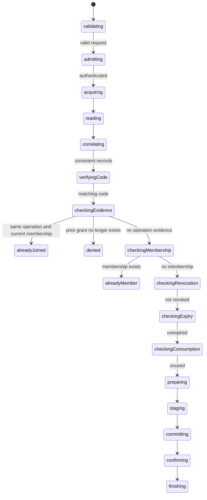

# Redemption transaction owner

## Scope and storage mapping

Compose the reviewed admission/transaction boundary into one finite server-owned statechart. No
HTTP endpoint, native table/permission definition or UI is introduced in this review. Native storage
mapping is deliberately app-owned; the exact normalized record and staging contracts below are the
required adapter interface, not an assertion that any local query is authoritative.

The input has credentials plus operationId, invitationId and transient code. There is no body user ID,
role, membership ID or workspace ID to trust. Admission supplies the verified account and its
attributed transaction access. A supplied `read` leaf reads the invitation, that account's current
membership and the authenticated operation evidence in the same exclusive transaction, returning
one coherent authority observation or `unavailable`. If the pinned SDK cannot provide that snapshot,
return unavailable and do not authorize from local absence. Read-tier/completeness qualification is
still mandatory when implementing the native mapping; a complete-looking array is not proof.

Normalized invitation record: id, workspaceId, codeDigest, expiresAt (service epoch milliseconds or
null), revoked, role, and consumed (accountId/operationId/membershipId or null). Membership: id,
workspaceId, accountId. Operation evidence: operationId, invitationId, workspaceId, accountId,
membershipId. Evidence is looked up by verified account and operation ID; foreign or mismatched
records fail closed. Missing records are represented explicitly as null. `role` is an opaque native
app value and is never supplied by the redemption body.

The code comparison leaf checks the supplied code against the private digest using the server's
chosen cryptographic mechanism. It makes no membership decision or storage call. Codes must have
sufficient random entropy; do not use a low-entropy password with an unkeyed digest. Issuance/hash
format and the constant-time native verifier are separate adapter work. No invitation code is
returned, logged, put in a query/path or written into operation evidence.

A trusted service clock is sampled after verification. Expiry means `now >= expiresAt` at this
eligibility check; this is not a claim about authority commit time. Check that all clock/expiry
values are finite. The stage leaf writes exactly the prepared membership, consumed invitation
marker and non-secret operation evidence together in this transaction. It does no querying or
eligibility branching. A single-use tombstone retains digest/consumption for authenticated replay
and status; do not delete the only evidence needed to distinguish used/revoked from absent.

## Decision order and ownership

Refusals and already-member decisions do not mutate data; roll back the read transaction before
finishing. Those decisions rely on the supplied coherent authority observation, not on a local
persistence receipt. The accepted write path reports joined only after exclusive confirmation.
A repeated accepted operation returns joined only while its exact membership still exists. An old
receipt never recreates access after removal. A current membership can return alreadyMember even
when this invite later expires or is revoked; it grants no new membership or role. For a nonmember,
revocation, expiry and consumption are checked before preparing IDs or staging writes.

The statechart owns one transaction through every path. Control is parallel with work. Cancellation
and shutdown drain admission/acquisition; an acquired handle is retained before checking interruption.
Reads, verification, preparation and staging finish before rollback. Before commit, rollback must
return true to report definite notStarted settlement. After commit invocation, interruption drains
commit/confirmation and preserves actual confirmation or uncertainty. Shutdown outranks cancellation.
There is no automatic retry or background invocation from ordinary app startup.

Unknown commit/confirmation and failed/false rollback return a server-only `retained` resource
handoff (verified account, transaction, optional write receipt, and confirm/rollback capabilities). This transfers ownership to the host; it must
retain and reconcile those resources or clean up its backend owner. Do not discard them on HTTP
response completion or serialize them to a client. A client transport returns only a confirmed
decision; every unresolved server operation remains a transport failure/unknown client settlement.
No promise that a failed rollback released the transaction is made. This handoff avoids leaking
an active handle by clearing it from the finishing actor without an identified next owner.

## Effects and failure boundaries

Each invoked promise executes one leaf: admit, acquire, read one related snapshot, verify one code,
sample clock, generate one membership ID, stage one already-decided batch, issue commit, confirm,
or rollback. A reused effect envelope catches raw exceptions before they become normal actor error
data; unexpected actor failures also have explicit fallback paths. No exception text is in the
public result. The admission result and transaction output must be retained even if interruption
arrives while a promise is pending. Entry/exit actions perform no asynchronous effects.

Terminal actions clear credentials, code/request, admitted capabilities, private records, plan,
transaction and receipt references from context after preparing the result/handoff. Hosts must also
release input objects and never attach raw-input/snapshot inspectors to this secret-bearing owner.
Reference cleanup is not guaranteed memory erasure. The host owns the ready backend session and
is the receiver of any unresolved resource handoff; this operation never replaces/closes it.

## Review and qualification

Implement the contract and statechart first; no tests for this new owner before review. Then cover
every decision, interruption during each effect, stale/mismatched evidence, removal/replay, expiry
boundary, one atomic stage/commit, true/false/failed rollback, commit/confirmation uncertainty and
resource transfer/secret cleanup. Native schema mapping, real bearer admission, denied private reads,
concurrent redemption and exact exclusive read-set semantics remain subsequent integration tasks.
Neither the previous permissive notes fixture nor these generic contracts prove invitation policy.

## Implementation review status

Implemented the normalized records/plan/result contracts and `workspace/invitations/authority-workflow`.
The workflow accepts native admission and transaction capabilities without creating an SDK session.
It copies the input body fields on initialization, drops credentials after admission, and drops the
code after verification. Terminal cleanup removes remaining private snapshot/role/capability refs;
unknown settlement instead explicitly hands native resources and confirm/rollback access to the
host. The handoff excludes open/commit capabilities, so it does not offer implicit replay. Its
verified account plus public operation identity supports host-owned status reconciliation.

Recursive effect audit: each promise invokes one capability through a shared exception envelope.
Decision ordering is in guarded states, including matching evidence, removed membership, expiry and
consumption. Stage receives a prepared plan; it cannot select a role from the body. No native schema
query, HTTP transport, transaction callback or global retry loop is hidden in this owner.

Strict TypeScript, focused lint/format, declaration packaging and strict publint pass. No tests were
added/run for this new owner before review. The existing 32 client and 18 adapter tests are separate
prior evidence, not evidence for this new statechart or invitation policy. After review, qualify the
owner, then bind and qualify the native storage mapping before exposing an endpoint.
