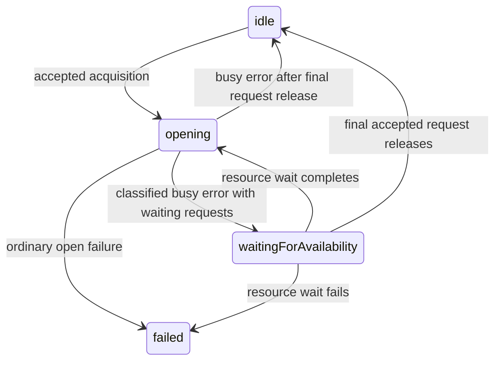

# Preserve Finance session availability while linking library source

Finance's active Local First archive includes an existing worker-storage recovery
extension absent from imported library source. Linking that source directly would
remove `SessionOpenCapability.availability` and registry
`getCurrentSessionAvailability`, losing the waiting behavior in Finance's current
integration. This slice carries that existing archive behavior into source; it
does not add a Finance domain workflow or a new backend plugin.

## Ownership and transitions

The existing session-acquisition owner retains requests and any eventual SDK
session. Its open leaf performs one SDK creation; the optional availability
adapter classifies a known busy error and waits on one cancellable resource key.
Finance continues to own SDK error parsing and browser Web Locks outside DLF.

Additional accepted acquisitions/retries join the existing wait; invalid scopes
remain rejected. Leaving the wait state cancels its invoked leaf through the
native AbortSignal. A release acknowledges only that attachment and does not
release other requests. Wait completion permits one new opening attempt;
ordinary failure keeps existing explicit retry semantics. No timer/polling loop,
secondary promise cache, backend-owned session state or persistence claim is
introduced. The registry observes the owner's waiting snapshot; it does not own
a second lifecycle. Existing session drain/close behavior stays with the owner.

## Source and acceptance

Port the contracts and statechart hunks of Finance's committed
`vendor/delightful-local-first-worker-recovery.patch`; the alpha.60 SDK adapter
hunks are already in source. Add the archive's registry observer. Preserve the
existing source feature selector and link this migration record from its backup
spec artifacts rather than changing sibling feature state.

Read the local XState memory/design review and installed XState 6.0.0-beta.1
`docs/agents.md` / `docs/api-stability.json`; no XState patch/upgrade is required.
Test observable outcomes with controlled resource admission: successful wake and
single re-open, waiting-request sharing, final-release cancellation, wait failure,
ordinary failure and stale-scope rejection. Retain existing acquisition tests.
Qualify library exports/packed consumers, then replace only Finance's active DLF
archive with a peer-specific workspace link and run the Finance type/unit,
account/recovery, permission and cold-offline/startup checks. Clipper's worker
and offline qualification covers its existing source behavior and must remain
valid after the optional capability is added.

The ported contracts and acquisition source match the patch's exact resulting
Git blobs (`86ce088c9ea25421a3b11c450b8fa995205fb50a` and
`1f7764d3eb0d7827f27d0e1c98e838770b80cb64`). Seven new behavioral tests cover
waiting/sharing/cancellation/failure/stale release/owner stop, and a public Jazz
registry test covers availability observation through successful acquisition.
All 1,098 library unit tests pass (52 files), including those eight additions.
Library type checks, package/publint and the existing consumer build/native
fixture checks pass; this is source compatibility qualification before app links.

The initial source link exposed different Jazz peer instances between Finance
and its injected library: pnpm 10.28 deduped the direct SDK to an optional-peer
superset while the injected library kept the earlier SDK subset. Jazz's branded
snapshot/branch types correctly rejected that mixture. The root lock now selects
the same already-resolved injected DLF / SDK peer context as Clipper web for all
three consumers, preserving Svelte 5.57.2, the same SDK version/patch and existing
optional-peer resolution. No dependency version, cast or SDK declaration is
changed. The standard pnpm peer deduplication setting is retained. See the
[versioned pnpm settings](https://github.com/pnpm/pnpm.io/blob/main/versioned_docs/version-10.x/settings.md).

`pnpm monorepo:check-links` inspects actual installed resolution for all three
apps and both source libraries. It requires workspace links and identical Svelte,
Jazz client, XState and UI peer module identities within each consumer. All six
library edges pass. Root, Finance and Clipper CI run this check immediately after
frozen install, so a future peer-resolution change fails before compilation.
