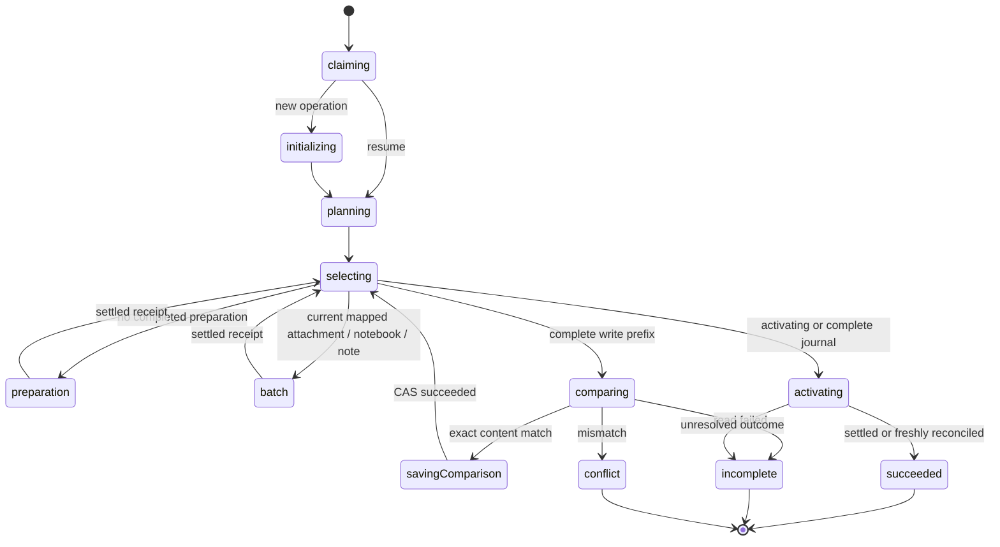

# Notebook restore completion

Authorized scope: full destination comparison, activation, complete coordination, tests and
large-file experiments in one PR. Finance adoption and new platform/size guarantees stay separate.

## Ownership and protocol

```text
notebook restore root (checked archive, binding, durable plan)
  resources (private content cleanup)
  identity observation (native subscription; latched invalidation)
  planner (existing finite actor)
  selected write (existing shared restore actor)
    journal, operation lock, transaction custody, domain destination actor
  comparison / activation destination actor
    fresh SDK graph read, pure exact projection/comparison
    existing identity/staging actor
```

The root claims once, initializes the journal for a new operation, plans once, selects the current
step from durable facts, invokes one writer at a time, compares, saves comparison, and activates.
Resume reconstructs the plan from the same checked file and retained mappings. Each successful
write supplies the next journal fact; no second cursor, loop flag, promise bridge or child-state
inspection selects domain work. Finite outputs are complete, conflict, unavailable, incomplete,
cancelled, closed or invalidated. Native read/write failures take those explicit paths.

Comparison reads the entire destination and all related rows freshly, including actual attachment
bytes. A pure projection remaps the archive IDs, checks scope and exact sets/fields/bytes, and
compares canonical record content and decoded attachment bytes directly. Receipts, row counts and stored digests alone are insufficient.
The root saves the correlated comparison with CAS before activation.
The root has explicit final success, incomplete, unavailable, conflict and interruption states;
its reporting decision classifies retained child outcomes once after resource drain. Activation uses the existing
journaled write/transaction owner, with the checkpoint helpers extended to the already-defined
activating/complete variants. It rechecks full content inside its transaction. Domain rows remain
immutable; activation must freeze further inserts at the backend. Active reconciliation compares
the full graph again; uncertain issued activation is never replayed on absence alone.

Control events CANCEL/SHUTDOWN/INVALIDATE and request RELEASE latch once and forward to the active
child. Root resources outlive drain. Identity observation spans the entire root and rejects A→B→A.
No retries, repair heuristics, extra supervisors, or cross-browser recovery are introduced.

## Verification and experiments

Use native Jazz/Chromium for a complete retained-file round trip, fresh session/reload, resume,
content mismatch, actual permission checks and an uncertain activation. Retain the existing write
drain tests instead of duplicating their full race matrix. Add focused shared activation checkpoint
tests. Run the full repository checks and browser suites.

Measure browser seal/open and restore latency, sampled memory, and event-loop delay at several
bounded sizes, including the current maximum attachment size. Record environment and methodology;
sampled heap is not total process peak memory and desktop measurements do not qualify phones.
Read-only Finance size inventory remains T007, so these establish a notebook baseline only.

The invocation/action distinction follows the installed XState 5.33.2 contracts and
[Stately invocation guidance](https://stately.ai/docs/invoke): invoked children own asynchronous
lifetimes; synchronous actions report facts and do not hide awaited workflows.

## Implemented statechart



Cancellation, shutdown, release and observed identity replacement latch and forward to the active
child, then enter their explicit final state after it settles. Resource cleanup precedes final
output. Stopping an actor is not the graceful cancellation protocol.

## Native activation experiment

The installed SDK's `whereOld` / `whereNew` update rules support an existence query against the
prior row. The qualified policy requires old owner/incomplete and new owner/active, with the same
ID, owner, operation, payload digest and graph digest in that prior row. This permits a single status
update, denies provenance changes, and retains immutable domain rows. No activation table is needed.
All new domain inserts require the parent to remain incomplete, so activation closes the write lane.

The content comparison is trusted owner-client policy. The server enforces owner/scope/phase and
unchanged provenance, not that arbitrary clients executed the comparison code. The archive declares
quiescent single-user consistency; this fixture does not claim a cross-client serializable graph
snapshot or a server-side archive verifier.

An exploratory foreign-client update could not reach server permission evaluation because this SDK
requires the existing row to be locally observed, even for a full update. The final tests therefore
retain actual server-denied forged-owner insertion and hidden foreign reads, and exercise activation
with changed ownership/provenance through the legitimate owner's observed row. They do not label a
client-side NotObserved rejection as a server authorization result.

## Qualification — 2026-11-04

The user authorized implementation, experiments and tests together for this PR. Final local checks:

- `pnpm verify`: formatting, lint, Svelte/TypeScript, **923 unit cases**, strict package/Publint,
  public consumer type/runtime/build checks, **17 independent reader cases**, **18 notebook export
  cases**, and Storybook build pass.
- `pnpm check:backup-restore`: **60 actual Jazz/Chromium cases pass**. Three opt-in measurement
  cases are skipped in this functional command and passed separately with `pnpm measure:backup`.
- `pnpm test:storybook`: **65 cases pass**.
- Private-creation fixture TypeScript and native Vitest suite: **10 cases pass**.
- `pnpm measure:backup`: all **three 1/4/8 MiB encrypted export/open/full-restore experiments pass**.
  See [measurements and methodology](notebook-performance.md).
- `git diff --check` passes. The branch descends from merged main `7816b88`.

That is 1,093 functional cases plus three measured experiments. The new cases cover complete
retained-file export/independent inspection/restore, fresh-session exact comparison, original
source/file preservation, exact fields/references/bytes and complete sets, cancellation before
activation, an actual extra-row conflict, reload/resume, immutable provenance and frozen active
content, a remotely accepted activation with an unfinished journal, request release/identity-loss
drain and private-content cleanup, and a finite read failure followed by resume. Shared activation
cases cover settlement, required local evidence, no unknown-write replay and final-checkpoint failure.
Existing staged-write race/drain tests remain the transaction qualification, rather than a copied
matrix for every coordinator state.

The first full run exposed a test assumption that a foreign client could issue an update without
observing the private row; the SDK rejects that locally. The test now exercises changed-ownership
activation through an observed owner row and requires an actual `permission_denied`. A clean full
60-case rerun passes. No NotObserved result is accepted as a server authorization result.

The retained source is the fixture's in-memory source actor, and the destination/policies are actual
Jazz. Page reload and fresh session are covered in the same browser/origin with retained IndexedDB
and reselected bytes. This does not qualify a browser-process crash, lost/cleared journal, offline
restart, cross-device recovery, production Finance completeness or mobile performance. No live data,
identity, storage configuration or deployment was changed.
